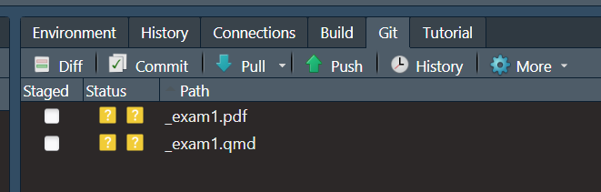

\vspace{-1cm}

|                                                          |                                                           |
|------------------------------------|------------------------------------|
|                                                          |                                                           |
| First name: \_\_\_\_\_\_\_\_\_\_\_\_\_\_\_\_\_\_\_\_\_\_ | Last name: \_\_\_\_\_\_\_\_\_\_\_\_\_\_\_\_\_\_\_\_\_\_\_ |

> I hereby state that I have not communicated with or gained information in any way from my classmates during this exam, and that all work is my own.

\vspace{5 mm}

> Signature: \_\_\_\_\_\_\_\_\_\_\_\_\_\_\_\_\_\_\_\_\_\_\_\_\_\_\_\_\_\_\_\_\_

\vspace{2 mm}

**Any potential violation of NC State's policy on academic integrity will be reported to the Office of Student Conduct & Community Standards. All work on this exam must be your own.**

1.  You have 75 minutes to complete the exam.
2.  Every MC question is worth 3-points unless otherwise specified.
3.  Every True/False question is worth 2-points unless otherwise specified.
4.  You are **not** allowed a cell phone, even if you intend to use it for checking the time, music device or headphones, notes, books, or other resources, or to communicate with anyone other than the professor during the exam.
5.  Please answer exactly and only what the question is asking.

Good luck!

```{r}
#| echo: false
#| message: false
#| warning: false

library(tidyverse)
```



### Matching: Git and GitHub (8-points)

Match each Git/GitHub command with its correct definition. Write the corresponding number on the blank next to the correct definition.

| Command    | Definition                                                                                     |
|------------------------------------|------------------------------------|
| 1\. Push   | \_\_\_\_\_\_\_\_\_\_\_ Moves changes from your local repository to GitHub. \vspace{0.25in}     |
| 2\. Pull   | \_\_\_\_\_\_\_\_\_\_\_ Selects changes to be included in the next commit. \vspace{0.25in}      |
| 3\. Stage  | \_\_\_\_\_\_\_\_\_\_\_ Downloads changes from GitHub to your local repository. \vspace{0.25in} |
| 4\. Commit | \_\_\_\_\_\_\_\_\_\_\_ Records a set of changes in your local Git history. \vspace{0.25in}     |

1.  **True or False** (2-points): When you open a project in RStudio, you must make sure to run `install.packages()` every time to make sure your packages are downloaded and ready to use for that specific project.

<!-- -->

a.  True

b.  False

\vspace{0.25in}

2.  **True or False** (2-points): When you open a project in RStudio, you must make sure to run `library()` every time to make sure your packages are opened and ready to use for that specific project.

<!-- -->

a.  True

b.  False

\vspace{0.25in}

3.  What do you use to index elements in a data frame or vector (3-points)?

<!-- -->

a.  ()

b.  \[\]

c.  {}

d.  \|\>

\vspace{0.25in}

4. **Fill in the blank** (4-points) : When you save an R-object with the _____ operator, you can see the R-object saved in the _______________ tab in RStudio.

## Reading Code (Rows & Columns: 10 points)

After all the NA values are removed from the data set, the classic penguins data set has 333 rows and 8 columns. Assume that all required packages were loaded/opened correctly. The breakdown of species can be seen below.

```{r}
#| echo: false
#| message: false
#| warning: false
library(palmerpenguins)

penguins |>
  na.omit() |>
  count(species)
```

The name of the columns can be seen below.

```{r}
#| echo: false
#| message: false
#| warning: false
names(penguins)
```

Using this information, read the following the code below. Next, determine how many rows and columns EACH of the three new data sets would have. Label your answers rows = and columns = . If the code would give an error, state that instead and EXPLAIN why. One of the three will give an error.

a.  

```{r}
#| eval: false
penguins |>
select(-body_mass_g) |>
filter(species != "Adelie")
```

\vspace{0.50in}

b.  

```{r}
#| eval: false
penguins |>
select(island) |>
filter(species == "Gentoo")
```

\vspace{0.50in}

c.  

```{r}
#| eval: false
penguins |>
arrange(desc(body_mass_g))
```

\newpage

## Catching Errors / Sloppy Code (21-points)

You receive the following R-code chunk from an AI model that is trying to answer the following research questions using the `mtcars` dataset:

1.  Do cars with more than 6 cylinders have better fuel efficiency than cars with 6 or fewer cylinders?

2.  Do cars with manual transmissions have a higher average MPG than cars with automatic transmissions?

However, you notice that this code has a ton of mistakes. A mistake is defined as sloppy / unnecessary code; code that doesn't pertain to the research question; improper code that produces an error.

There are **at least** 5 mistakes in the following code-chunk that fit this criteria. Your job is to:

1.  Number 5 mistakes you identify with a number and a circle around the number ex. $(1)$

2. In **ONE** sentence next to the number, explain why this is a mistake.

Here is a data table to help answer your question:

| Variable | Description                                      |
|----------|--------------------------------------------------|
| `mpg`    | Miles per gallon (in mpg)                        |
| `cyl`    | Number of cylinders                              |
| `am`     | Transmission type: `0` = automatic, `1` = manual |
| `hp`     | Horsepower                                       |

```{r}
#| echo: true 
#| eval: false
# Question 1

library(tidyverse)

mtcars2 <- mtcars |>
  filter(cyl > 6) |>
  mutate(mpg = mpg * 1.609) |>
  summarize(
    mean_mpg = mean(mpg),
    n = n
  ) 

# Question 2

library(dplyr)

mtcars |>
  mutate(
    transmission = ifelse(am = 1, "Manual", "Automatic")
  ) |>
  group_by(transmission) |>
  summarize(
    average_mpg = mean(mpg),
    average_hp = mean(hp)
  ) |>
  arrange(desc(average_hp))
```

\newpage

## Miscellaneous (17-points)

1.  In one sentence, define what the following code chunk options do when they are correctly used in a R-code chunk (6-points).

<!-- -->

a.  `#| echo: false` -

\vspace{0.50in}

b.  `#| eval: false` -

\vspace{0.30in}

2.  I'm claiming that the following table is a valid example of a data frame in R. Critique this claim. If you disagree, explain why AND explain how/what you would change/add/include with the data to make it a data frame (6-points).

| Student_Name    | Section_Number | Quiz_Score |
|:----------------|:--------------:|-----------:|
| John Doe        |       1        |         88 |
| Dylan Michaels  |       2        |         94 |
| Kyle McKee      |       2        |         93 |
| Peverel Shipley |                |         91 |
| Wen Seng        |                |            |

\vspace{0.90in}

3. Please see the following image. In 2-3 sentences, explain when these statuses appear in the Git tab. Be as detailed as possible (5-points).



\newpage

## ifelse (10-points)

The following code chunk is from the penguins dataset and the table is an example of the possible output with some values missing.

```         
penguins$size <- ifelse(penguins$body_mass_g > 50, "Big", "Small")
```

Using the above code, fill in the missing values in the table. HINT: For the last blank, fill in an example of what that body mass could be.

```{r}
#| echo: false
knitr::kable(
  data.frame(
    species = c("Adelie", "Gentoo", "Adelie", "Chinstrap"),
    body_mass_g = c("40.6", "53.4", "51.8", "______"),
    size = c("______", "______", "______", "Small")
  ),
  col.names = c("species", "body_mass_g", "_____"),
  align = "c"
)
```

## function-writing (8-points)

Please see the following function:

```         
calculate_total <- function(x, y) {
  total <- x + y
  total
}

calculate_total(x = 5, y = 10)
```

Based on the code above, write the correct response in the following \_\_\_\_\_\_\_\_\_\_\_\_\_\_\_.

-- Function name: \_\_\_\_\_\_\_\_\_\_\_\_\_\_\_\_\_\_\_\_\_

-- Argument(s): \_\_\_\_\_\_\_\_\_\_\_\_\_\_\_\_\_\_\_\_\_

-- Values of the argument(s): \_\_\_\_\_\_\_\_\_\_\_\_\_\_\_\_\_\_\_\_\_

-- Returned value(s): \_\_\_\_\_\_\_\_\_\_\_\_\_\_\_\_\_\_\_\_\_

\newpage

## YAML (6-points)

1.  **True or False**: A YAML is appropriate in either a .R file or a .qmd file.

<!-- -->

a.  True

b.  False

\vspace{0.25in}

2.  **True or False**: A YAML is space-sensitive (spacing / indentation matter).

<!-- -->

a.  True

b.  False


## Forms and Joins (20-points)

Please see the following output for a data frame called scores:

```{r}
#| echo: false

scores <- data.frame(
  student = c("Alex", "Alex", "Blair", "Blair", "Casey", "Casey"),
  quiz = c("Quiz1", "Quiz2", "Quiz1", "Quiz2", "Quiz1", "Quiz2"),
  score = c(8, 10, 9, 8, 7, 9)
)

scores
```

First, justify if these data are wide or long format in 1-2 sentences. Next, rewrite the data above to be in the other format in the table provided below. Include appropriate column names and all values (10-points).

\vspace{0.65in}

\begin{tabular}{|p{4cm}|p{4cm}|p{4cm}|}
\hline
\rule{0pt}{0.8cm} & & \\ \hline
\rule{0pt}{0.8cm} & & \\ \hline
\rule{0pt}{0.8cm} & & \\ \hline
\end{tabular}

\vspace{0.65in}

\newpage

2.  Now, suppose your colleague has a second data set (student_info), and they want to join it with the **original** scores data set in question 1 (not your answer to question-1).

```{r}
#| echo: false
student_info <- data.frame(
  student = c("Alex", "Blair", "Dylan"),
  major = c("Statistics", "Biology", "Mathematics")
)

student_info
```

To do this, they write the following code.

```{r}
#| echo: true
#| eval: false
inner_join(scores, student_info)
```

Fill in the table below to match the result of the code above. Note: There may be additional rows/columns in the template. If so, leave them blank/empty for the purpose of this problem. Include the appropriate column names (10-points).

```{=tex}
\begin{tabular}{|p{2cm}|p{2cm}|p{2cm}|p{2cm}|p{2cm}|}
\hline
 & & & & \\ \hline
 & & & & \\ \hline
 & & & & \\ \hline
 & & & & \\ \hline
 & & & & \\ \hline
 & & & & \\ \hline
\end{tabular}
```
