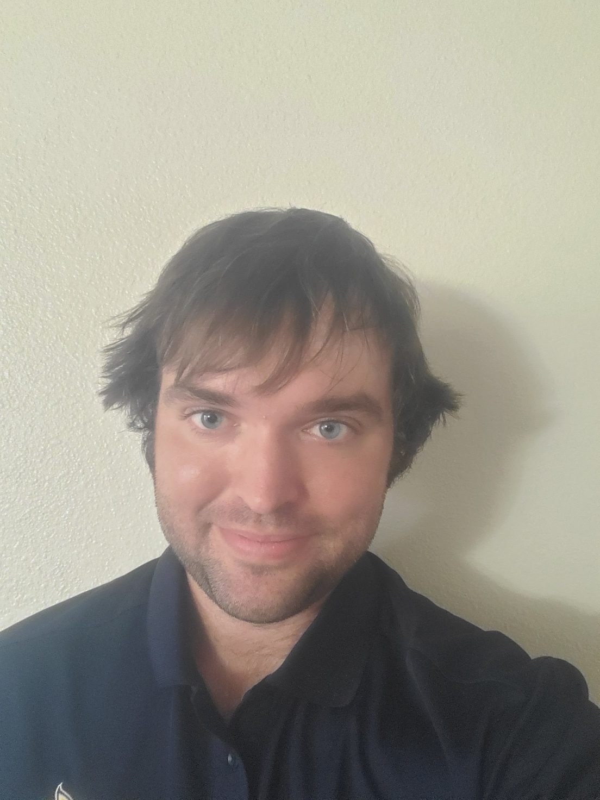
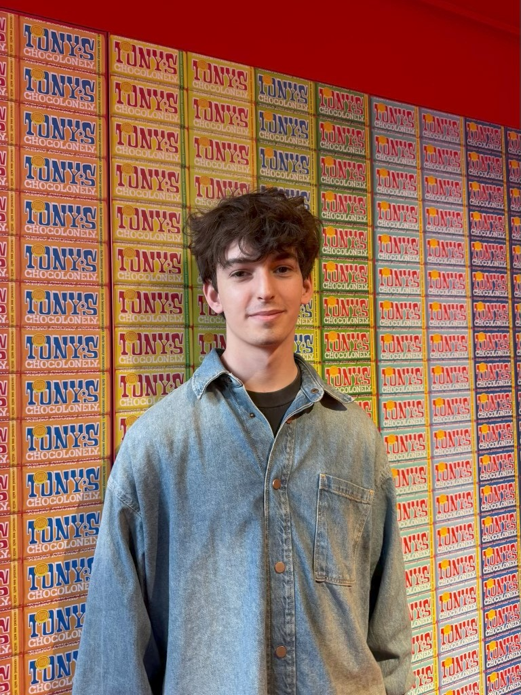

{width="150" height="180"
style="float:right;padding: 0 0 0 10px;"
fig-alt="Headshot of Dr. Elijah Meyer"}

[**Dr. Elijah Meyer**](https://elijahmeyer3.github.io/) - Hello! I'm
very excited to work with you all this semester. I've earned a Master's
degree in statistics and a Ph.D. in statistics with a focus in education
from Montana State University, and completed a teaching post-doc
position at Duke University. My early research is in sports statistics,
with an emphasis on spatial data visualizations to enhance sports
strategy. My current work is in statistics/data science education. My
focus is on improving the educational experience for both instructors
and students. Current projects include creating a dynamic interactive
shiny application in R to better students' understanding of statistics
and data science; exploring interest-driven assessment, and
creating an national data science assessment around reasoning. 

My student led projects include: 3D Printed Geometric Structures with Liquid
Metal as Flexible Sensors, & An assessment of wildlife use of rhododendron in western North Carolina.

Prior to my time at NC State, I've taught multiple sections of
Introductory Data Science at Duke University, and Introductory and
Intermediate Statistics at Montana State. At Montana State, I developed
their Intermediate Statistics online course, and helped integrate R into
the Introductory Statistics curricula.

I prioritize **community**, **communication**, and **respect** in my
classroom. I want to provide a space where we can freely talk about the
material, embrace mistakes, and learn together throughout the semester.

When I'm not in the books, I enjoy playing disc golf, tennis,
basketball, and anything else that gets me outside and active. I'm
looking forward to meeting you all and having a great semester!

## Instructor Office Hours

| Time                     | Location                                                                                       |
|-----------------|------------------------------------------------------|
| M 2:00 - 3:00pm   | SAS Hall 5228 / [Zoom](https://ncsu.zoom.us/j/9304565996?pwd=cEcrZjVSSGV1dnFCb0NxUEUxMHBLdz09) |
| Thur 1:30 - 2:30pm | SAS Hall 5228 / [Zoom](https://ncsu.zoom.us/j/9304565996?pwd=cEcrZjVSSGV1dnFCb0NxUEUxMHBLdz09) |

Note: It can be difficult to balance in-person and online office hours. If you attend office hours via Zoom and the room is not open, please do not hesitate to send an email.

\*\* or by appointment

## TA

{width="150" height="180"
style="float:right;padding: 0 0 0 10px;"
fig-alt="Headshot of Nick Mann"}

Nick Mann - Hi I'm Nick and I'm a second year PhD student. I graduated
from the University of North Carolina at Chapel Hill with a Bachelor's
degree in Applied Math and Statistics. In my free time, I like to play
music, work out, and watch TV. I think statistical methods and
programming are awesome, so I'm excited to work with you guys!

## TA Office Hours

| Time                | Location |
|---------------------|----------|
| Tue 3:15 - 4:15pm | SAS-1101 |
| Fri 9:00 - 10:00am | SAS-1101 |

## Videos

You will see that some *prepare* videos will largely feature [Dr. Mine
Çetinkaya-Rundel](https://mine-cr.com/). Mine is a Professor of the
Practice and the Director of Undergraduate Studies at the Department of
Statistical Science at Duke University. Mine is the creator and
maintainer of Data Science in a Box (a curricula we pull from in ST 115), and works
with Posit as a Developer Educator with the Tidyverse and Quarto teams.

Dr. Çetinkaya-Rundel and I continue to work on many educational projects
together, including developing a Data Science with R Coursera course,
and developing a national data science assessment for introductory
students.

## Course

The course will focus on the R statistical computing language. No
statistical or computing background is necessary.

Gain experience in data wrangling, exploratory data analysis, data
visualization, tests of significance, modeling techniques, and effective
communication of results, all in a reproducible format.

| Class meeting | Location       | Time                 |
|---------------|----------------|----------------------|
| Lecture       | 00110  Cox Hall | T & Th 8:30 - 9:45 pm |
