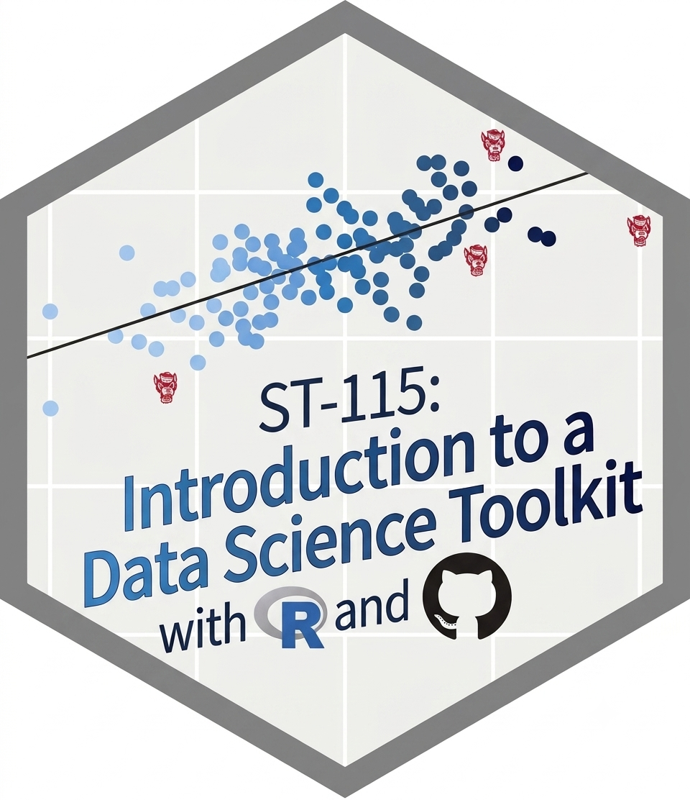
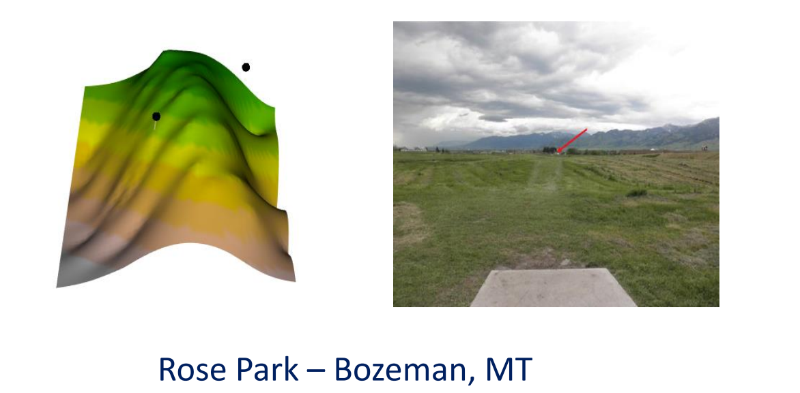
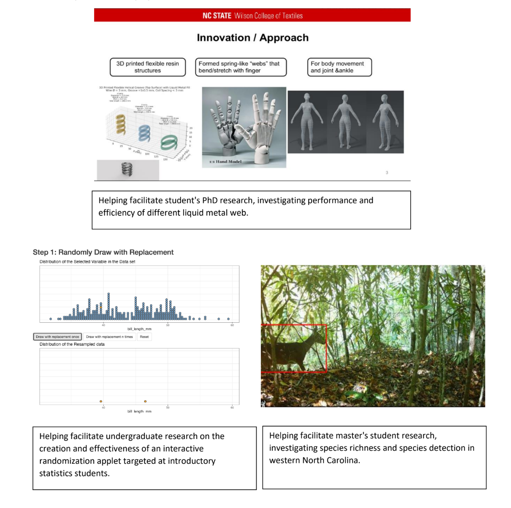
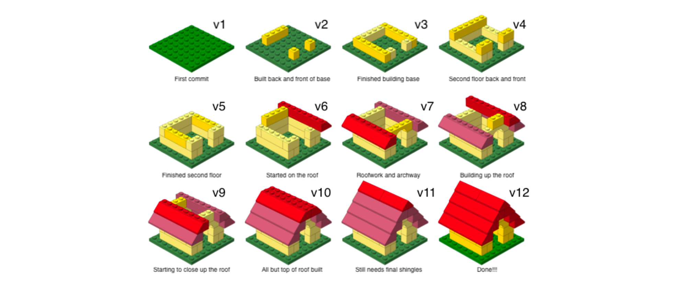
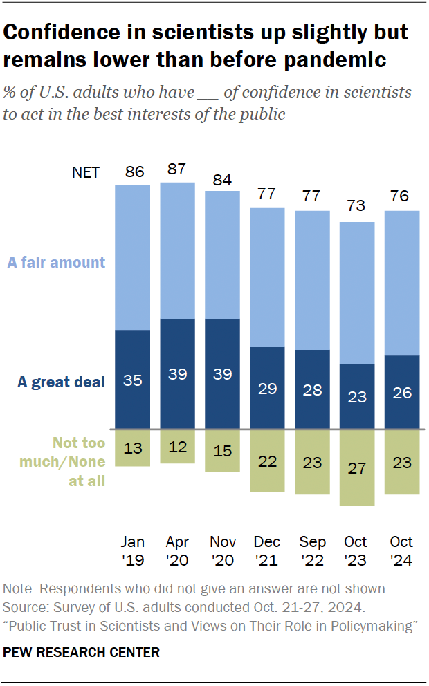
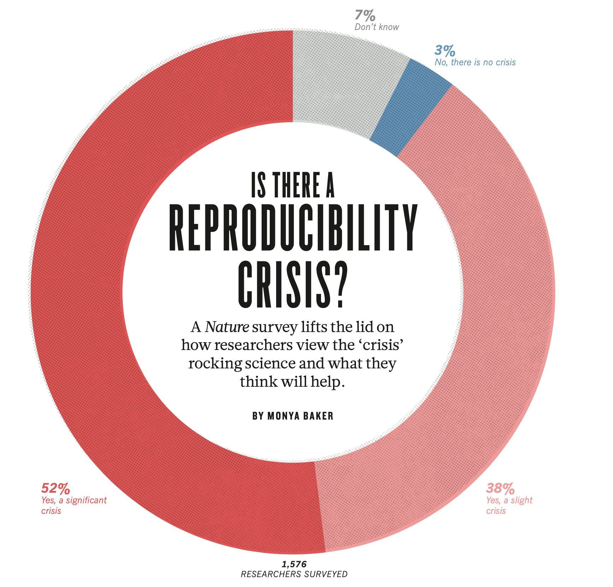
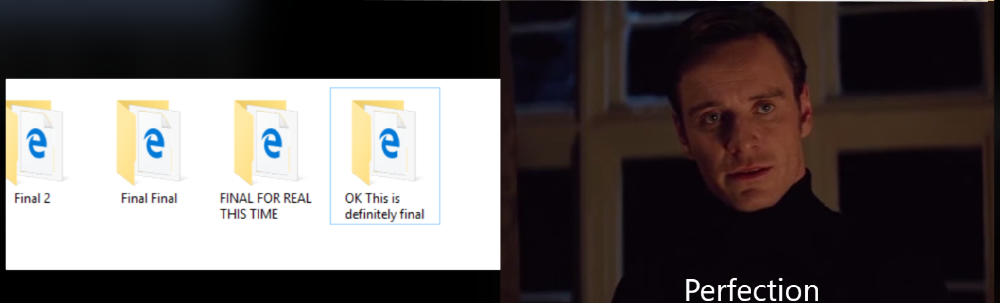
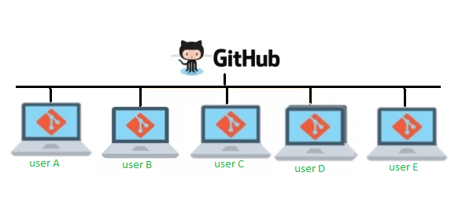
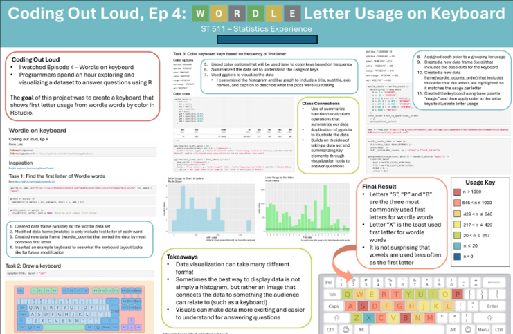
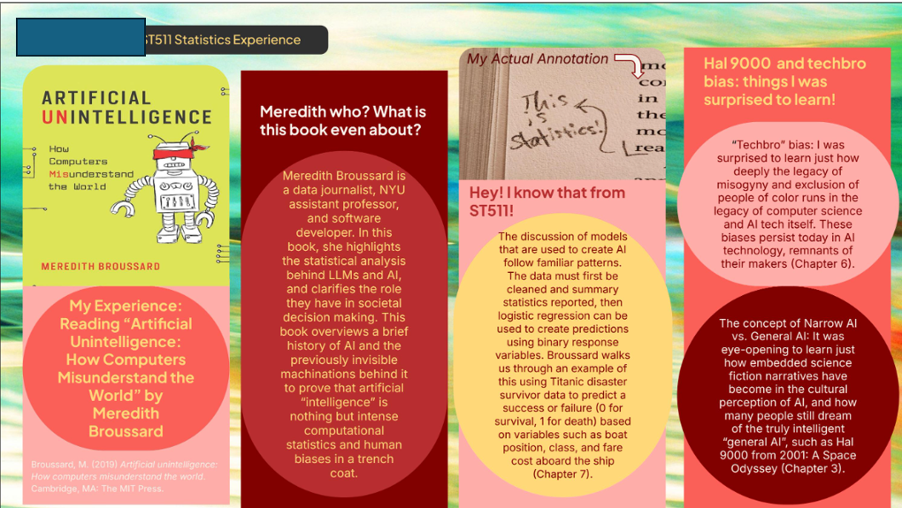

## Welcome

## Goals for Day 1

Get organized + review

-   Get to know the professor
-   Get to know each other
-   Course overview
-   Coding/Tech conversations (what, why, how)
-   Creating a GitHub account

## Who Am I?

::: {layout="[[100], [50,-10,50]]"}
{width="1000" height="300"}

{width="400" height="175"}

{width="400" height="175"}
:::

## At NC State

## At NC State

Project COMPASS (Community Partnership and Assessment for School
Safety). This is a three-year, federally funded initiative focused on
developing and piloting a data-driven framework to strengthen
collaboration between schools and community partners.

NC State undergraduate curriculum committee.

## Who Are You?

Please share with the class

-   Name
-   Major
-   Year (Freshman, Sophomore, etc.)
-   Why you are taking this course
-   Anything else

## How class runs

Build a community of learners

-- Communication

-- Respect

## ST-115

-- learn how to program: read, write, and explain the steps and purpose
of code using R programs

-- efficiently read in and manipulate data in R

-- build effective data visualizations

-- connect coding topics to concepts in ST-120

**Question**: Why?

## Why code

In the world of big data...We can try and make meaning with it!

[We can tell a story through graphs](https://r-graph-gallery.com/web-waffle-chart-for-evolution-of-energy-mix.html)

## Why code 

-- Public Health & Disease Tracking

-- Financial Risk Management

-- Environmental Forecasting

-- Legal and Policy Decision Making

-- etc!

## ST-115

-- learn how to program: read, write, and explain the steps and purpose
of code using R programs

-- efficiently read in and manipulate data in R

-- build effective data visualizations

-- connect coding topics to concepts in ST-120

**Question**: AI can do this for us... why are we learning this?

## AI in ST-115

There is nothing stopping you from using AI (such as ChatGPT) as an
additional resource to help build up your mastery of the material.
However, please use it responsibly.

-- It is suggested that you use AI as a generator for additional
practice problems

-- A tool to help uncover a misunderstanding you may have with ST 115
content

## AI in ST-115

Irresponsible uses of AI

-- Having it think for you

-- Only asking AI questions

Any work you turn in must be created by you! I'm interested in your
fundamental understandings

## AI in ST-115 {.smaller}

[Dialogues with AI Reduce Beliefs in Misinformation but Build No Lasting
Discernment Skills](https://dl.acm.org/doi/10.1145/3772318.3790656)

[Your brain on
ChatGPT](https://www.media.mit.edu/publications/your-brain-on-chatgpt/)

[How AI is reshaping human skills and
thinking](https://www.apa.org/monitor/2026/07-08/ai-job-skills-thinking)

-- I believe it's disingenuous for people to tell you to jump into using
AI

-- I believe it's disingenuous for people to tell you to never use AI

-- I try to be as transparent as possible with all of my in-class
decisions, so please do not hesitate to ask questions!

# Questions

# More Tech: Version Control

## Create a GitHub account (Why?)

GitHub, Inc., is an Internet hosting service for software development
and **version control**.

-- remote collaboration

-- project management

-- **keep track of changes to code / documents**

## GitHub

## Why GitHub

-- Why might this be useful for statisticians / data scientists?

## Why GitHub (and Quarto)

{fig-align="center"}

## Why GitHub (and Quarto)

GitHub, Inc., is an Internet hosting service for software development
and **version control**

{fig-align="center"}

## What do students get out of using GitHub?

Besides saving the world….

-- develop good habits as researchers

-- emphasize the importance of reproducibility in science

-- get experience using professional computing tools

## Avoid this

## Gain this

# Questions

# Course logistics

## Where to get help

| Who       | When                                         | Where            |
|-----------|----------------------------------------------|------------------|
| Dr. Meyer | Monday: 2:00-3:00pm \| Thursday: 1:30 - 2:30pm | SAS 5228 or Zoom |
| Nick Mann | Tuesday: 3:15 - 4:15pm \| Friday 9:00 - 10:00am              | SAS 1101   |

## Videos 

I will also post class videos for you to review (reminder: attendance is graded)

## Grades

| Category              | Percentage |
|-----------------------|------------|
| Proficiency Test      | 15%         |
| Programming/Statistics Experience     | 5%         |
| Attendance | 7.5%%         |
| GitHub Teamwork Assignment              | 2.5%        |
| Homework         | 15%        |
| Midterm-1           | 15%        |
| Quizzes         | 15%        |
| Final Exam         | 25%        |

## Proficiency Test

Timed programming assignments to demonstrate basic efficiency and master the first half of the course.

These will be completed during lab times. Please see our schedule for dates 

Note: based on the pacing of the course, the scheduled dates may change

## Programming/Statistics Experience

The goal of the programming/statistics experience assignments is to help you engage with the statistics, data science, and programming communities outside of the classroom!

1. Have an experience 

2. Make connections between our class, and the experience 

3. Make a slide (poster) summarizing your experience 

Connections can be topics of regression, coding, working with data, etc. 

## Student Example 

## Student Example 

## Attendance

-- 2.5% for showing up to class

-- 2.5% for showing up to lab 

-- 2.5% for completion of lab assignments 

## GitHub Teamwork Assignment

In pairs, you will demonstrate an understanding of how to use GitHub as a collaborative tool. This will happen in the second half of the semester. 

## Homework

-- Combination of handwritten assignments and coding assignments 

-- Turned in via Gradescope 

## Quizzes

-- Combination of Moodle quizzes or short in-class quizzes. In-class quizzes will be announced in advance.

## Midterm and Final exam 

In-class assessment (no live coding) to demonstrate your mastery of the material

# Questions 

## Moodle and our website

We will only use Moodle for...

-- announcements 

-- quizzes 

-- gradebook 

Your course material is organized on a website I have made for the course

Let's tour both together

# ToDos and reminders

## ToDos 

-- Bring your laptop to class 

-- Bring your laptop to lab

-- Complete the *Getting to know you* survey **with** a GitHub username

-- Always feel like you can ask questions 

## Create a GitHub account {.smaller}

Go to <https://github.com/>, and create an account (unless you already
have one).

Some tips from Happy Git with R.

-- Incorporate your actual name!

-- Reuse your username from other contexts if you can, e. g., Twitter or
Slack.

-- Pick a username you will be comfortable revealing to your future
boss.

-- Be as unique as possible in as few characters as possible. Shorter is
better than longer.

-- Avoid words with special meaning in programming (e.g. NA).

# See you Thursday!
