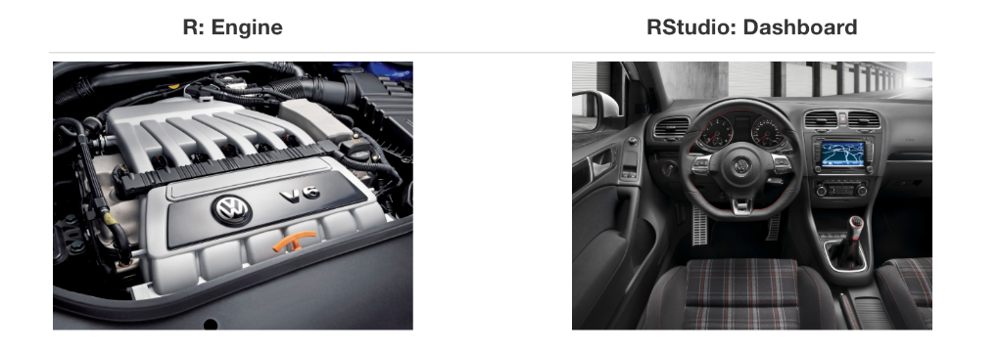
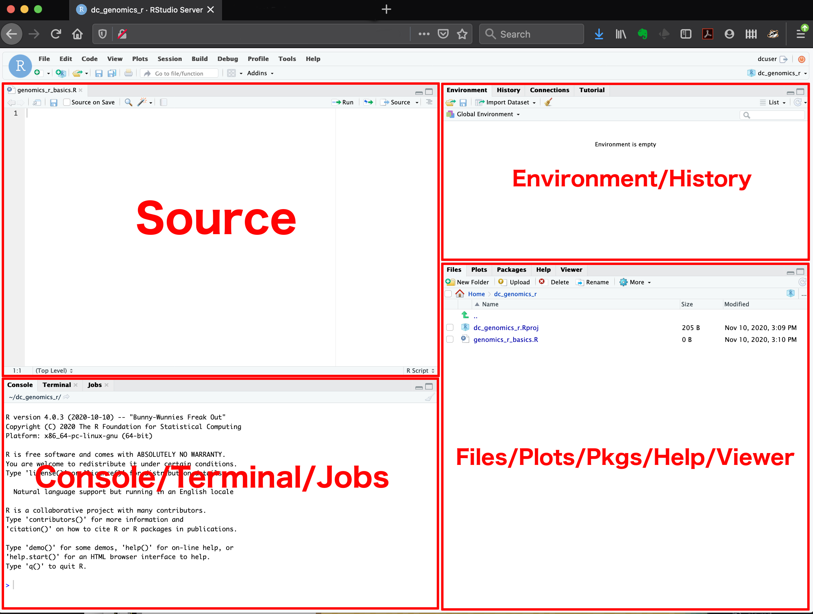
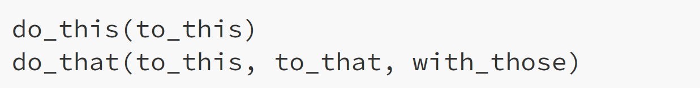
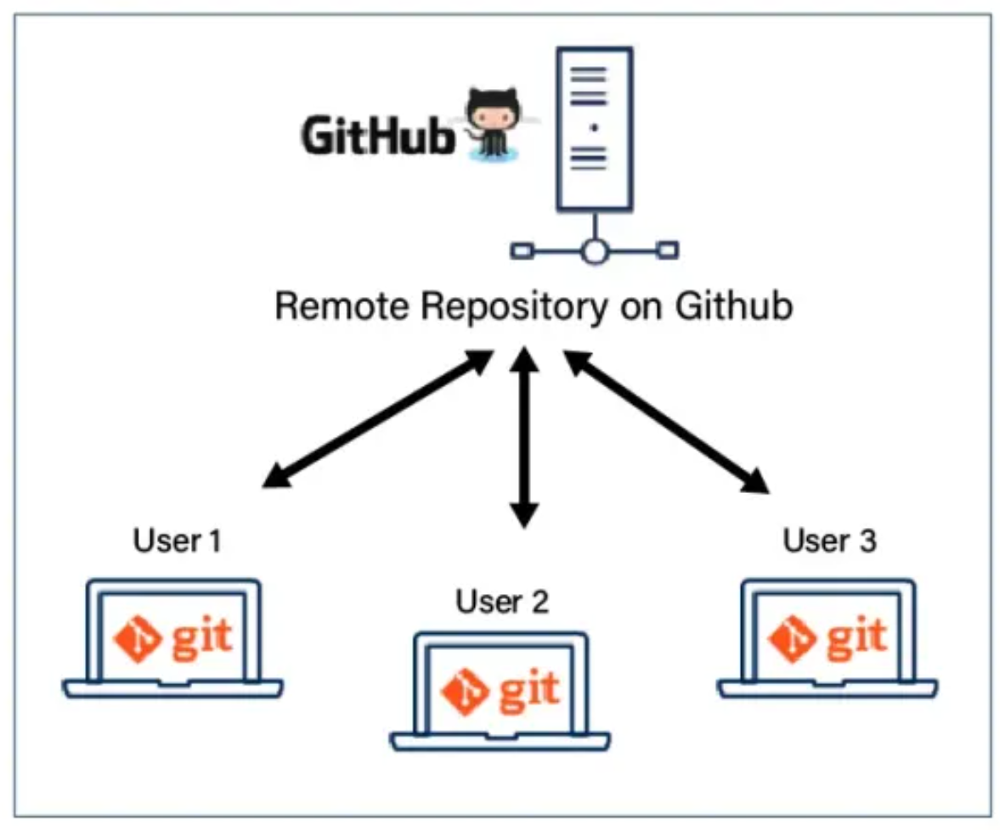
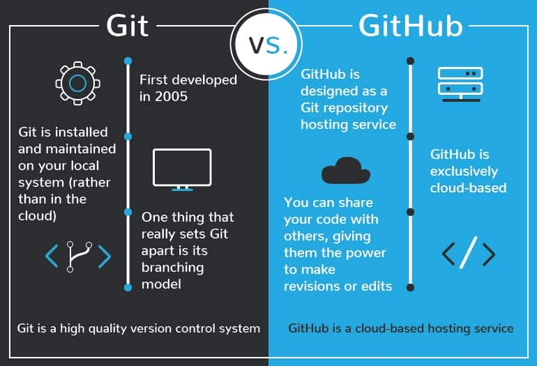
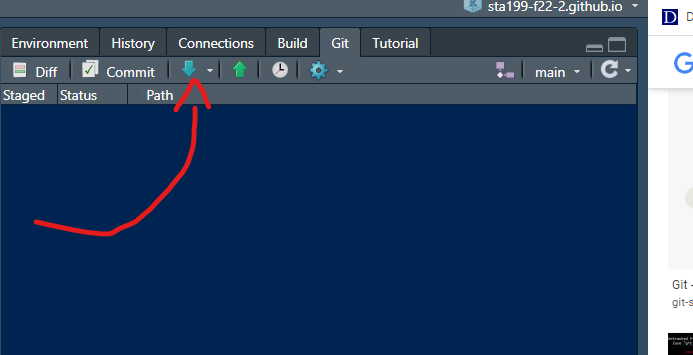
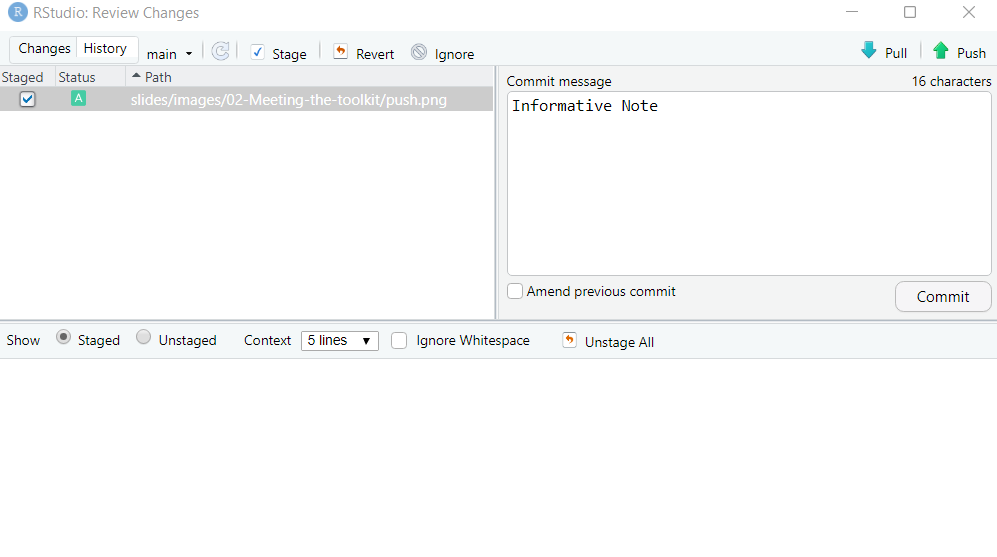
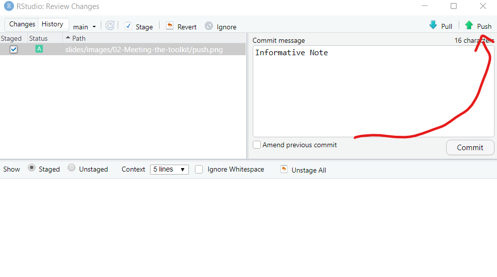

## Checklist{.smaller} 

-- Did you engage with the prepare material?

-- Did you install R + RStudio?

-- Do you know how to get help in ST115?

-- Have you filled out the *Getting to know you survey*? 

      --- due Friday at 11:59pm 
      
      --- need to have made a GitHub account to receive full credit 

If you can't access RStudio, you can use this link [here](https://webr.r-wasm.org/latest/) and then please see me after class.

## Goals for today 

-- Articulate the difference between R & Rstudio 

-- Start writing R code + using the RStudio platform

-- Introduction to GitHub, and how we will use it this semester (if time)

## What is R and RStudio?

-- R is a statistical programming language

-- RStudio is a convenient interface for R

{width="500" height="200" fig-align="center"}

## Base R

Base R means the R language and the built-in packages/functions that come with a standard R installation, without relying on additional packages. We will learn more about packages in a couple week!

[The R Base Package](https://search.r-project.org/R/refmans/base/html/00Index.html)

And we are going to learn some code now! 

First, let's explore the RStudio layout.

# RStudio-layout 

## R-layout 

In summary 

## Some R essentials

-- **Functions** are (normally) verbs, followed by what they will be applied to in parentheses:

## Some R essentials

An **argument** in R is a value that you give to a function to tell it what you want the function to do.

Note: functions can have multiple arguments, and they are separated by commas. 

## ICA 

-- `c()`

-- `str()`

-- `mean()`

-- `<-` assignment operator 

-- `iris` data set in base R

... and how to pull up help files!

## `c()`

Think about `c()` as **combine**

We can think about using when we want to take *elements* and put them together 

let's put together the number 1, 2, and 3!

This is called a vector. We will learn more about vectors next week!

## `<-`

This arrow is called the *assignment operator*. 

We read this as "anything on the right is assigned to what the arrow points to on the left" 

Name your vector the letter `a`.

## `mean()`

Now, take the `mean` of your object `a`.

Extension: Use the following link to look up more functions that perform calculations. Try them out on your object a!

[More functions](https://maths.dur.ac.uk/stats/stats2/r_5_basicstats.html)

## Challenge Question{.smaller} 

-- `iris` is the name of the data set in R. Pull up the help file for the `iris` data set to read more about it!

-- Next, use the `str()` function on the `iris` data set. What information is this telling us?

-- Next, run the code `iris$Sepal.Length`. What happens? 

-- Next, run the code `iris$sepal.width`. What happens? 

-- Calculate the `mean` of the iris petal length. 

## Challenge Question

-- Create a R object named `number` that has the following values: 1, 3, 15, NA, 40

-- Try and take the `mean` and report the value. Note: you should get 14.75. 

## GitHub motivation 

{fig-align="center"}

## Git vs GitHub 

Very very similar to R vs RStudio 

{fig-align="center"}

## GitHub Commands: Pull Commit Push

{fig-align="center"}

## GitHub Commands: Pull Commit Push

{fig-align="center"}

## GitHub Commands: Pull Commit Push

{fig-align="center"}

## Next Time 

-- How can we make professional documents?

-- Practice with more code 

-- Don't forget to fill out the getting to know you survey!

-- Don't forget to save your work! You are building up your notes / resources.

# Quarto 