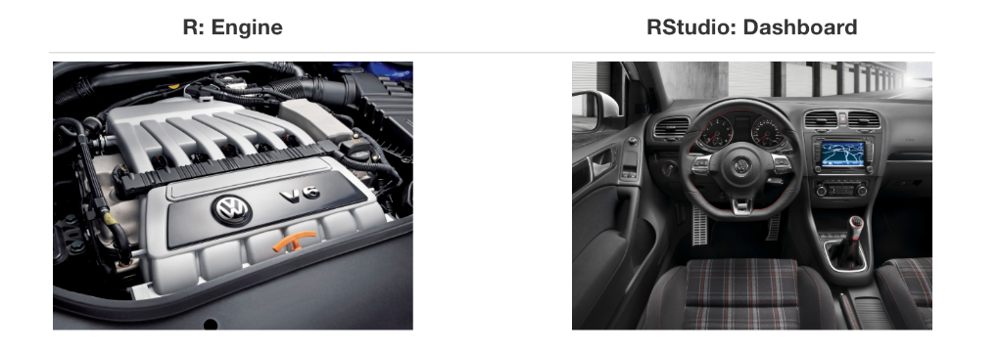
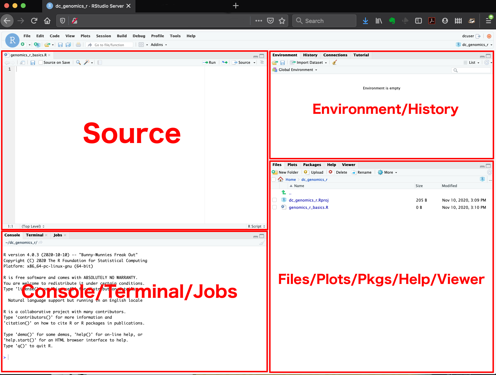
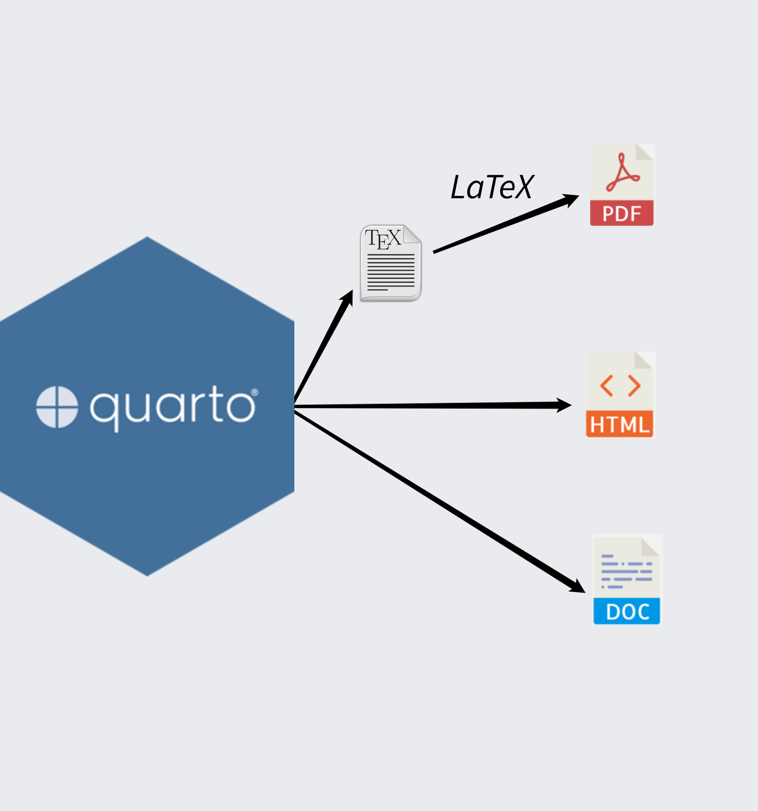
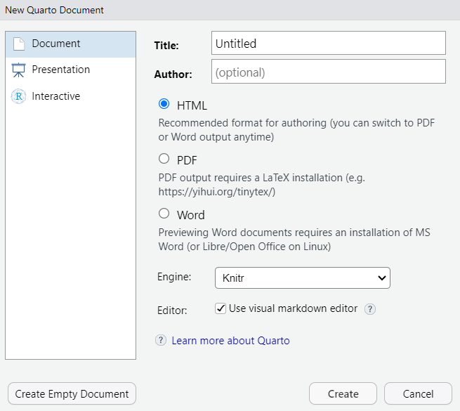
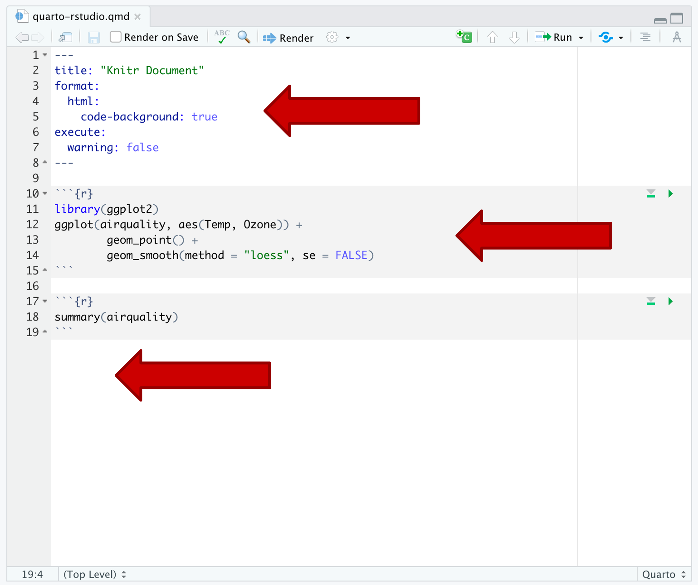

## Checklist{.smaller} 

-- Did you engage with the prepare material?

-- Do you have a plan for taking notes?

-- The attendance sheet will be passed around! Please sign-in.

-- Quiz released today (due Friday) on Moodle

      --- lowest quiz-score dropped 
      --- no late policy on quizzes

-- Do you know how to get help in ST115?

-- Open up RStudio and have a .R file ready to go!

## Warm-up 

What is the difference between R and RStudio?

## Warm-up 

{width="500" height="200" fig-align="center"}


## Warm-up 

Describe what each RStudio panel is for...



## Challenge Question

-- Create a R object named `number` that has the following values: 1, 3, 15, NA, 40

-- Try and take the `mean` and report the value. Note: you should get 14.75. 

# Questions 

# Quarto{.smaller}

Quarto is an open-source scientific and technical publishing system that lets you combine text, executable code, and data analysis results into dynamic documents, reports, presentations, websites, books, and dashboards



## Quarto 

Ways I've used Quarto...

-- Publications 

-- Your ST-115 website 

-- These slides... 

-- ... and more!

## Quarto 

The quarto file extension is .qmd 

*File -> New File -> Quarto Document* 



## Source vs Visual 

-- Source tab shows raw plain-text markdown and code 

-- Visual tab provides a WYSIWYG (what-you-see-is-what-you-get) interface. This is useful for: 

      --- Those brand new to code (Microsoft Word feel) 
      --- Creating tables
      --- Seeing (mostly) what your document will look like rendered
      
I'm going to suggest you work in the Source tab primarily, but feel free to work in both as we move throughout the semester.

## Quarto Document 

Three pieces: 

YAML, R-code chunk, and where text goes!



## Code block/chunks{.smaller}

PC/Windows: Ctrl + Alt + I

Mac: Cmd + Option + I

**I want you now to title your document, add a R code chunk that has the code `2+2` in it, and click Render! 


## Code block/chunk options 

Code block options are included in a special comment at the top of the block (lines at the top prefaced with #| are considered options).

Options available for customizing output include:

[Code chunk options](https://quarto.org/docs/computations/execution-options.html)

## Code block/chunk options 

We are going to explore the following:

-- echo:

-- eval: 

-- message: 

-- warning: 

## Challenge Question 

Add to your code chunk so that it looks like the following:

```
2+2
warning("Something might be wrong!")
message("Here's some information for you.")
```

Let's do echo together, and then you will do the other three on your own.

In your Quarto document, type out what each of these code chunk options do! Practice writing text underneath your code chunks.

## Important 

We will go through when/when not to use these. PLEASE do not hide your code when you turn in homework assignments..... 

## Question 

What do you think happens if this is at the top of your document?

```
---
title: "My Document"
execute:
  echo: false
---
```
## YAML{.smaller} 

We have mappings and keys! 

You can think of the "map" as a YAML option. You can think of the "key" as the value the option takes on. 
```
---
title: "My Document"
---
```
title is the "map" and "My Document" is the key!

Note: When we are working with a simple string, the quotes are optional. When you are working with things likes numbers that you want to be treated as text, quotes are necessary.

[Options](https://quarto-tdg.org/yaml.html)

## YAML{.smaller} 

What's the difference?

::: {.columns}

::: {.column width="50%"}

**Example 1**

<pre><code>---
title: "Test Document"
author:
name: Elijah Meyer
affiliation: NC State University
---</code></pre>

**Example 2**

<pre><code>---
title: "Test Document"
author:
- name: Elijah Meyer
affiliation: NC State University
---</code></pre>

:::

::: {.column width="50%"}

**Example 3**

<pre><code>---
title: "Test Document"
author:
  - name: Elijah Meyer
    affiliation: NC State University
---</code></pre>

:::

:::


## YAML

The `-` is necessary when we have a list item (an item that we could have multiple of)

```
author
  └── list item
        ├── name
        └── affiliation
```

**Most** (not all) YAML headings require indentation. This is a good habit to get into early.

# Questions 

## Section Headers 

`#` Main Section/First Level heading

`##` Subsection/Second Level heading

`###` Sub-subsection/Third level heading

`####` Sub-sub-sub...? Fourth-level heading

# Questions 

## Common Errors 

-- Code chunks not closed 

-- Incorrect code preventing rendering 

Let's demo this together!

# Questions 

## Challenge Question (if time){.smaller}

-- Make a new quarto document

-- Title is "Iris-Practice" and put yourself as the author 

-- Pull up the help file for the `iris` data set (and discuss if we should include the help file in the Quarto document or not)

-- Make a level-2 section header and title it "Description" 

-- Copy the description text into your Quarto file

-- Answer the question: "Which species had the larger median petal length?". Use code to justify your answer. 

# Questions

## In Lab 

-- Review topics from today's class

-- Install the necessary software to Render to a PDF


