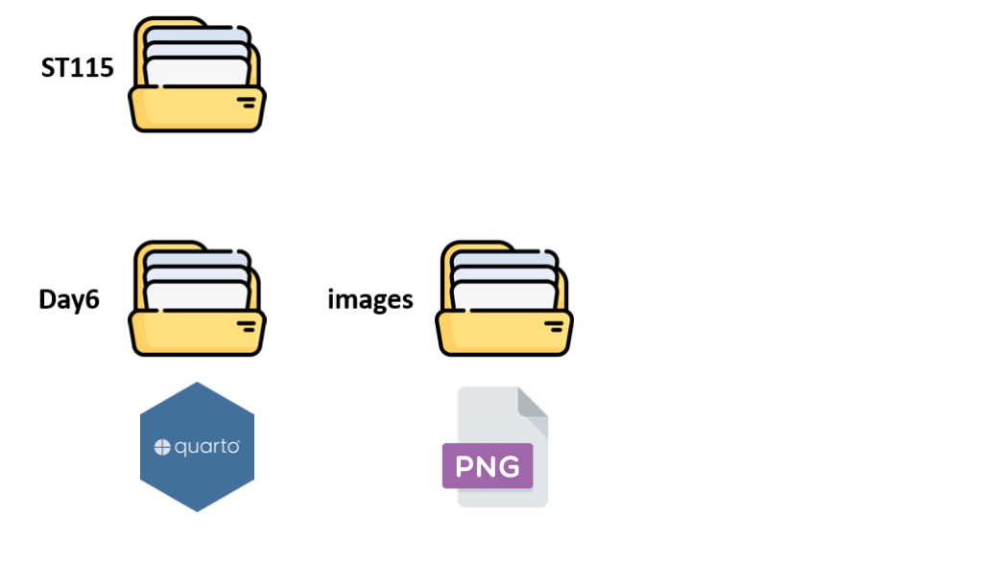
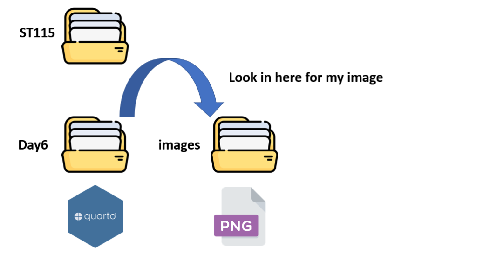

## Check list 

-- Did you engage with the prepare material?

-- Quiz-2 due Friday at 11:59pm 

-- Homework-1: assigned Friday (11-4); due Friday (11-11)

-- Proficiency test II (11-22)

## Quarto tip of the day! 

Sometimes, you will use code to create data visualizations that are rendered in your document. 

Other times, you will want to display a still png or jpeg image in your .qmd file. 

This is what we are going to learn today! 

## Images

```

```

-- ! tells quarto that this is an image 

-- [] allows us to put a caption on our figure 

-- () allows us to specify the name of the .png AND the necessary file path to access the png

## Suggested File Path 



## Suggested File Path 




URL-style paths: use / to "move to the next level"

```

```

## On your own 

-- Set up a file structure you are comfortable + confident in

-- Download the wolf png from Moodle

-- Embed it into your .qmd file

-- Render your document 

## Customize your picture

We can customize the size and location of our image using {}


```
{width = 300}
{width = 80%}
{width = 4in}
```


The default units for width and height are pixels. You can also specify sizes using a percentage or a conventional measurement like inches or millimetres.

Note that if only width is specified then height is calculated automatically. If you need to modify the default behaviour just add an explicit height attribute.

## Customize your picture 

Figures are center aligned by default. Add the fig-align attribute to the image to use a different alignment. For example:

```
{fig-align="left"}
```

We can use "left", "right" or "center" 

## Alt text 

```
{fig-alt="A drawing of something."}
```

## All together 

Attributes are separated by a space, not a comma:

```
{width="900" fig-alt="A drawing of something." fig-align="right"}
```

## On your own

With your image of a wolf...

-- Change the width

-- Add alt text (and understand the difference between alt text and caption)

-- align your figure a certain direction

# Questions

## Goals for today 

-- Practice with for loops

-- Practice with while loops 

-- Understand if else logic in code


## Warm-up{.smaller} 

What happened last time? Why don't I have values in my first for loop, but I do in my second (next slide)?

```{r}
#| echo: true
#| eval: false 

student <- list(
  name = "Alice",
  age = 19,
  scores = c(92, 88, 95)
)

for (x in student) {
  print(x)
}

```

## Warm up{.smaller}

```{r}
#| echo: true
#| eval: false 
iris2 <- iris

for (i in 1:nrow(iris2)) {
  iris2$Sepal.Length[i] <- iris2$Sepal.Length[i] * 2
}

iris2 
```

## Types of iteration 

Container or box iteration (collective)

```{r}
#| echo: true
#| eval: false 
for (x in student) {
  print(x)
}
```

**We don't care where the value is located**. Just give me the value!

## Types of iteration{.smaller} 

Indexed iteration (position)

```{r}
#| eval: false
#| echo: true
iris2 <- iris

for (i in 1:nrow(iris2)) {
  iris2$Sepal.Length[i] <- iris2$Sepal.Length[i] * 2
}

iris2 
```

**The position matters!** We need the `i:nrow(iris2)` to position us. 

## Question

What does the following code do?

```{r}
#| eval: false
#| echo: true

for (x in iris) {
  print(x)
}
```


## For vs While (Warm up)

What is the difference?

## Questions{.smaller}

Now, let's practice on when we might use each! 

Hint: You don't need to just start with a loop! Write the first iteration without the loop to make sure you know what's going on!

1. Use a ___ loop to go through the first 10 rows of iris and print each flower's Petal.Length.

2. Use a ___ loop to start at the first row of iris and print Sepal.Length values until you reach a flower with a Sepal.Length greater than 7.

3. Use a ___ loop to go through the rows of iris and count how many flowers you encounter before reaching the first Virginica.


4. Use a ___ loop to start at row 1 and keep adding the Sepal.Width values together until the running total exceeds 20. Print the total when the loop stops.

## Hint

Math operations

| Operator | Meaning |
|---|---|
| **<** | less than |
| **<=** | less than or equal to |
| **>** | greater than |
| **>=** | greater than or equal to |
| **!=** | not equal to |
| **==** | equal to |

# Questions 

## if else motivation 

Based on the wording, what do we think if else logic is? 

Or, what could if else statements help us accomplish?

## if else motivation 

if/else statements let your code make decisions (decisions that you pre-code)

“If this condition is true, do this. Otherwise, do that.”

## if statement 

Type this code into your .qmd file. Run it when your R object is equal to 10. What if it is less than 10?

```{r}
#| echo: true 
#| eval: false
x <- 10

if (x > 5) {
  print("x is greater than 5")
}
```

## if else statement 

Add to the code on the previous slide that will print the text "x is 5 or less" using an `else` statement. 

Note: an `else` statement opens and closes exactly like the if statement!

## Extension 

We can have multiple `if else` statements. 

-- Create an R object called `score` and assign the value 71 to it for starters. 

-- Create an if else statement that prints **A** if the score is at least 90

-- A **B** if the score is at least 80

-- A **C** if the score is at least 70 

-- A **F** if the score is anything else 

## Extension 

Let's go back to the `iris` data set. Suppose that a flower with a Petal Length larger than 4 is considered a large flow. 

Here, we are going to learn how to create a new variable in base R, and fill the new variable with values from the if else statement! 

As a reminder, what does the following code do?

```{r}
#| echo: true
#| eval: false 

iris$Petal.Length
```

## Extension 

Run the following code. What happens?

```{r}
#| echo: true
#| eval: false 
iris$Petal.Size <- 5

iris$Petal.Size <- NA
```


## I've got this 

Run this, it works... I promise...

```{r}
#| echo: true
#| eval: false

iris$Petal.Size <- if (iris$Petal.Length > 4) {
  "Large"
} else {
  "Small"
}
```

What is happening?

What might we need to do?

## Extension 

Now, use this logic, and a for loop, to create a Petal.Size variable that has the value of "Large" if the Petal Length is larger than 4, and "Small" if Petal Length is 4 or smaller.

# Don't look 

## Solution

```{r}
#| echo: true
#| eval: false

iris$Petal.Size <- NA

for (i in 1:nrow(iris)) {
  if (iris$Petal.Length[i] > 4) {
    iris$Petal.Size[i] <- "Large"
  } else {
    iris$Petal.Size[i] <- "Small"
  }
}

iris
```


# Questions 

## Vectorized operations 

-- if / else - operate on one value (so we need to iterate with a for loop)

-- In R, vectorized means that a function can OPERATE on a whole vector of values at once, instead of requiring you to process each value individually with a loop (ifelse)

## Example 

-- mean(): not vectorized. It takes a vector as an input and produces a value. It does not operate on the entire vector

-- round(): rounds each value in a vector. "Does something independently to each element".  This is consider vectorized!


## Test yourself 

Which functions are vectorized?

```{r}
#| echo: true
#| eval: false

x <- c(2,4,6)

length(x)

sqrt(x)

unique(x)

x > 2

```

# Questions 

## ifelse

Pull up the help file for ifelse

Now, create a new variable in the iris data set for the Sepal.Size. Have it say "Large" if the value is above 5.5, and "Small" for anything else. 

# Don't look!

## Solution 

```{r}
#| echo: true
#| eval: false

iris$Sepal.Size <- ifelse(
  iris$Sepal.Length > 5.5,
  "Large",
  "Small"
)
```

# Questions 

# See you Tuesday
