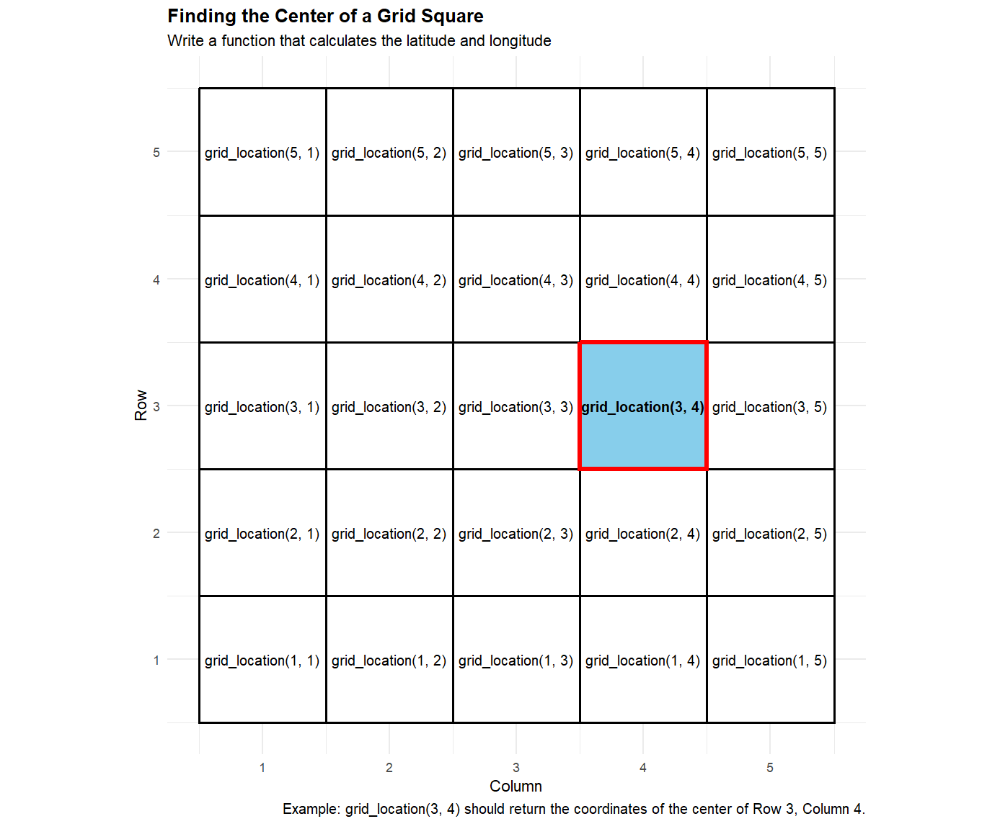

## Checklist 

-- Did you engage with the prepare material?

-- No quiz this week!

-- Homework-1: assigned Friday (11-4); due Friday (11-11) on Gradescope!

-- Proficiency test II (11-22)

-- I posted the for loop solutions from last class on Moodle

## Lab today 

Your lab today is very important! 

You are going to install Git and GitHub. 

We can't learn about these tools unless you have them on your computer. 

## Git and GitHub 

Note: The installation process is a bit more involved than downloading R and RStudio

Please follow along with Nick, and we will handle any individual issues that arise on a case-by-case basis. 

Let's demo what you should be able to do by the end of lab! 

## GitHub Demo

[Public Repo](https://github.com/ElijahMeyer3/ST115-Practice-Repo)

This would be a good time to check that you gave me your GitHub username in the excel spreadsheet for the *Getting to know you* quiz!

## Quarto tip of the day 

inline code! 

Code results can be inserted directly into the text of a .qmd file by enclosing the code with `r `.

Why might we want to do that? 

## inline code 

-- Find the max value of Petal Length in the `iris` data set

-- Write a sentence reporting the max value using inline code

Note: You will only be able to see this after you render your document!

# Questions 

## if else 

How did we think about if else code last class? 

What problems does it help us solve?

## if else motivation 

if/else statements let your code make decisions (decisions that you pre-code)

“If this condition is true, do this. Otherwise, do that.”

## Exercise 

We can have multiple `if else` statements. 

-- Create an R object called `score` and assign the value 71 to it for starters. 

-- Create an if else statement that prints **A** if the score is at least 90

-- A **B** if the score is at least 80

-- A **C** if the score is at least 70 

-- A **F** if the score is anything else 

## Hint

Math operations

| Operator | Meaning |
|---|---|
| **<** | less than |
| **<=** | less than or equal to |
| **>** | greater than |
| **>=** | greater than or equal to |
| **!=** | not equal to |
| **==** | equal to |

# Don't look!

## Solution 

```{r}
#| echo: true
#| eval: false
score <- 71

if (score >= 90) {
  print("A")
} else if (score >= 80) {
  print("B")
} else if (score >= 70) {
  print("C")
} else {
  print("F")
}
```

## Extension 

Let's go back to the `iris` data set. Suppose that a flower with a Petal Length larger than 4 is considered a large flow. 

Here, we are going to learn how to create a new variable in base R, and fill the new variable with values from the if else statement! 

As a reminder, what does the following code do?

```{r}
#| echo: true
#| eval: false 

iris$Petal.Length
```

## Extension 

Run the following code. What happens?

```{r}
#| echo: true
#| eval: false 
iris$Petal.Size <- 5

iris$Petal.Size <- NA
```


## I've got this 

Run this, it works... I promise...

```{r}
#| echo: true
#| eval: false

iris$Petal.Size <- if (iris$Petal.Length > 4) {
  "Large"
} else {
  "Small"
}
```

What is happening?

What might we need to do?

## Extension 

Now, use this logic, and a for loop, to create a Petal.Size variable that has the value of "Large" if the Petal Length is larger than 4, and "Small" if Petal Length is 4 or smaller.

# Don't look 

## Solution

```{r}
#| echo: true
#| eval: false

iris$Petal.Size <- NA

for (i in 1:nrow(iris)) {
  if (iris$Petal.Length[i] > 4) {
    iris$Petal.Size[i] <- "Large"
  } else {
    iris$Petal.Size[i] <- "Small"
  }
}

iris
```


# Questions 

## Vectorized operations 

-- if / else - operate on one value (so we need to iterate with a for loop)

-- In R, vectorized means that a function can OPERATE on a whole vector of values at once, instead of requiring you to process each value individually with a loop (ifelse)

## Example 

-- mean(): not vectorized. It takes a vector as an input and produces a value. It does not operate on the entire vector

-- round(): rounds each value in a vector. "Does something independently to each element".  This is consider vectorized!


## Test yourself 

Which functions are vectorized?

```{r}
#| echo: true
#| eval: false

x <- c(2,4,6)

length(x)

sqrt(x)

unique(x)

x > 2
```

# Questions 

## Writing your own function 

R has a bunch of pre-packaged functions! 

Why might we write our own?

## Writing your own function 

-- A custom function is useful when you have a general procedure that you want to apply repeatedly to different inputs.

-- Make code easier to read 

-- If you need to accomplish a task, and you don't know the origins of the pre-packaged function 

## Writing your own function 

Things we need to note: 

You need to pick a name for the function that makes sense!

ex. the `mean()` function takes a mean!

## Writing your own function 

You list the inputs, or arguments, to the function inside function

## Writing your own function 

You list the inputs, or arguments, to the function inside function

```
function(inputs and arguments go here!)
```

## Writing your own function 

The code that you want the function to execute goes inside the curly braces { } after function(...).

```
function(inputs and arguments go here!) {

code to execute goes here!
}
```

## Example 

```
double <- function(x) {
  x * 2
}
```

-- What is the name of the function?

-- What is x called?

-- What is this function doing?

## Extension{.smaller} 

You are working with a map divided into a square grid. Each square is identified by its row and column.

The grid has the following coordinate system:

The bottom-left corner of the grid is at latitude $35.00^\circ$ and longitude $-78.00^\circ$.

Each grid square is 0.01° of latitude tall and 0.01° of longitude wide.

Moving up one row increases latitude by $0.01^\circ$.

Moving right one column increases longitude by $0.01^\circ$.

I want a function that will allow me to pick a row and column, and git the latitude and longitude of the center of the square!

## Example 




## Equation

For example, the center of the square in row 3, column 4 would be:

$$ \text{Latitude}=35.00+(3-0.5)(0.01) $$
$$ Longitude=−78.00+(4−0.5)(0.01) $$

## Input Output 

grid_location(3, 4)

Latitude: 35.025

Longitude: -77.965

## Motivation 

Without a function, you'd have to repeatedly write the latitude and longitude calculations. With a function, you can simply provide the row and column, and R does the calculations for you.

Write the `grid_location` function below, and verify you are correct by checking `grid_location(3, 4)` with the previous slide

# Questions 

## More practice 

Write a function that takes the bill amount and the tip percentage as inputs and returns the dollar amount of the tip.

## More practice 

Task: Write a function called pick_homework() that uses sample() to randomly select n homework assignment(s) from the homework vector.

```
homework <- c("Reading", "R Practice", "Problem Set", "Quiz", "Discussion")
```

Hint: use the `sample()` function. Check out the help file!


# Did we need to do that?

## More practice 

A weather app gives you the probability of rain and the number of hours you'll be outside. You want to create a simple measure of your overall "rain exposure."

Define rain exposure as: $\text{Rain Exposure} = \text{Probability of Rain} \times \text{Hours Outside}$

Then run the following code: 
```
rain_exposure(0.20, 5)
rain_exposure(0.70, 2)
rain_exposure(0.40, 8)
```

## Did we need to do that?

Yep! Without a function...

0.20 * 5
0.70 * 2
0.40 * 8

A custom function is useful when you have a general procedure that you want to apply repeatedly to different inputs.

# Questions 

# See you Thursday!


