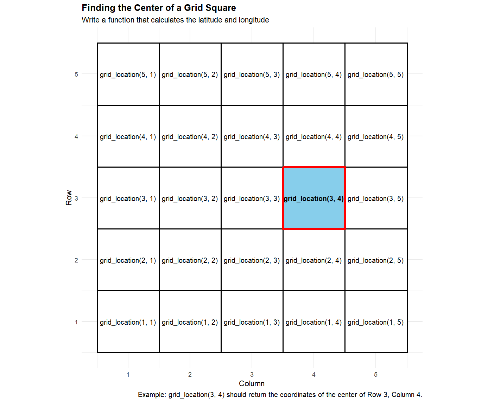

## Checklist {.smaller}

-- Did you engage with the prepare material (none for today)?

-- No quiz this week!

-- Homework-1: assigned Friday (9-4); due Friday (9-11) on Gradescope!

```         
  > Please see the Moodle announcement if you haven't yet
```

-- Proficiency test II (9-22)

-- I sent you a GitHub organization invite. Go to github.com and accept
it (right hand corner)

-- I'm sure lab was hectic! Can you clone a repo?

```         
  > If yes, let me know on the GitHub excel sheet
  > If no, please see announcements / plan to visit office hours / set up an appointment 
  > Nick: Fri 9:00 - 10:00am
  > Dr. Meyer: M 2:00 - 3:00pm 
  > My goal for you is to be ready to roll for class Tuesday on how to use GitHub
  
```

## Clone a repo!

Practice makes permanent

Let's practice the steps to clone a GitHub repo!

# Questions

## RStudio Tip of the day

Rainbow parentheses!

-- Navigate to the Tools menu at the top of RStudio.

-- Click on Global Options.

-- Select the Code tab on the left sidebar, and then click the Display
tab at the top.

-- Look near the bottom and check the box for Rainbow Parentheses.

## Quarto (not really Quarto) tip of the day!

I want to very briefly introduce the world of LaTex and writing out math
equations in quarto, so you can connect these skills to what you are
learning in ST120 (and other courses).

## LaTeX Resource

LaTeX is like a programming language that helps you embed math text into
a professional document.

Click
[here](https://webapps.math.uci.edu/~xiangwen/pdf/LaTeX-Math-Symbols.pdf)
for a list of symbols that we can write in a .qmd file using LaTex.

## Warm-up

Last class, we talked about writing our own function.

What goes in the following \_\_\_ when writing your own function?

```{r}
#| echo: true
#| eval: false

___ <- ___(___) {
  ___
}
```

## Last time

Task: Write a function called pick_homework() that uses sample() to
randomly select n homework assignment(s) from the homework vector.

```{r}
#| echo: true
#| eval: false
homework <- c("Reading", "R Practice", "Problem Set", "Quiz", "Discussion")
```

Hint: use the `sample()` function. Check out the help file!

And I asked you... did we really need to write this?

## Last time {.smaller}

Creating `pick_homework()` doesn't give you a meaningful practical
advantage here.

... in fact, we actually lose some functionality if we are not carful...

```{r}
#| echo: true
#| eval: false

homework <- c("Reading", "R Practice", "Problem Set", "Quiz", "Discussion")

pick_homework <- function(n){
  sample(homework, n)
}
```

# Questions

## More practice

Suppose now you want to calculate your final grade at the end of the
semester. Your grade was made up the following way:

final - 50%

midterm - 30%

homework -20%

Write this custom function + practice explaining why it might be useful
to write a function for this situation.

## General Rule {.smaller}

"if the inputs change, but the process remains the same"

If you find yourself pasting the same code more than once

If you have something unique you need to solve, repeatedly (ex. reading
in data sets a specific way)

If a custom function makes your code easier to read or maintain.

Use an existing R function when it solves the problem. Write your own
function when you need to create a reusable process that isn't already
available as a simple function.

# Questions

## Extension {.smaller}

You are working with a map divided into a square grid. Each square is
identified by its row and column.

The grid has the following coordinate system:

The bottom-left corner of the grid is at latitude $35.00^\circ$ and
longitude $-78.00^\circ$.

Each grid square is 0.01° of latitude tall and 0.01° of longitude wide.

Moving up one row increases latitude by $0.01^\circ$.

Moving right one column increases longitude by $0.01^\circ$.

I want a function that will allow me to pick a row and column, and git
the latitude and longitude of the center of the square!

## Example



## Equation

For example, the center of the square in row 3, column 4 would be:

$$ \text{Latitude}=35.00+(3-0.5)(0.01) $$
$$ Longitude=−78.00+(4−0.5)(0.01) $$

## Input Output

grid_location(3, 4)

Latitude: 35.025

Longitude: -77.965

## Motivation

Without a function, you'd have to repeatedly write the latitude and
longitude calculations. With a function, you can simply provide the row
and column, and R does the calculations for you.

Write the `grid_location` function below, and verify you are correct by
checking `grid_location(3, 4)` with the previous slide

## Putting it all together

We'll use the built-in iris dataset. The Petal.Length column contains
the petal length for each flower.

Goal: Look at each petal length and print "this is too big" whenever the
petal length is greater than 6.5.

How might we go about this?

## if

```{r}
#| echo: true 
#| eval: false

if (iris$Petal.Length[1] > 6.5) {
  print("this is too big")
}
```

and why do we need a for loop?

## Code

Please fill in the \_\_\_\_ that helps answer our question

```{r}
#| echo: true 
#| eval: false
for (i in 1:length(iris$Petal.Length)) {
  
  if (________________________) {
    print(________________________)
  }
  
}
```

## Extension

I want you to be able to check a variety of of characteristics on the
flower (ex. Sepal Length). What components of the for loop do we need to
change to make a function that is reusable for a variety of situations?

Note: I also want you to print the entire row of the data set that has
too big of Petal Length. Think about adding another input to help
accomplish this!

Try this on your own and then let's do it together.

## Print vs return

Change `print()` to `return()` when outputting the entire row.

-- What happens?

-- Why might this be useful?

# Questions

## More practice (variable creation)

We want to create a Petal.Size variable that has the value of "Large" if
the Petal Length is larger than 4, and "Small" if Petal Length is 4 or
smaller.

Run the following code. What happens?

```{r}
#| echo: true
#| eval: false 
iris$Petal.Size <- 5

iris$Petal.Size <- NA
```

Now, use a loop, to create a Petal.Size variable that has the value of
"Large" if the Petal Length is larger than 4, and "Small" if Petal
Length is 4 or smaller.

# Don't look

## Solution

```{r}
#| echo: true
#| eval: false

iris$Petal.Size <- NA

for (i in 1:nrow(iris)) {
  if (iris$Petal.Length[i] > 4) {
    iris$Petal.Size[i] <- "Large"
  } else {
    iris$Petal.Size[i] <- "Small"
  }
}

iris
```

# Questions

## Putting it all together 

-- Make a Quarto document 

-- Download the irisflower.jpg from Moodle

-- Correctly embed the image into your document 

-- Make it so that when you click the image, it takes you to the Iris Wiki page (on Moodle)

-- Hyperlink a word while you are at it! 

Please see the following resource [here](https://quarto.org/docs/authoring/markdown-basics.html#links-images)

# Questions 

## Please take this time to 

-- Ask questions about GitHub 

-- Work on homework-1 

-- etc.

