## Checklist {.smaller}

-- Did you engage with the prepare material

-- Moodle quiz this week (due Friday at 11:59pm)

-- Homework-1: assigned Friday (9-18); due Friday (9-25) on Gradescope!

-- Proficiency test II (9-22)

-- Go to the following website and favorite it: <https://github.com/orgs/ST115-Fall26/repositories>

      > do you see a github-practice repo with your name attached?
      > If yes, great!
      > If not, please let me know after class

-- I'm sure lab was hectic! Can you clone a repo?

## Git and GitHub

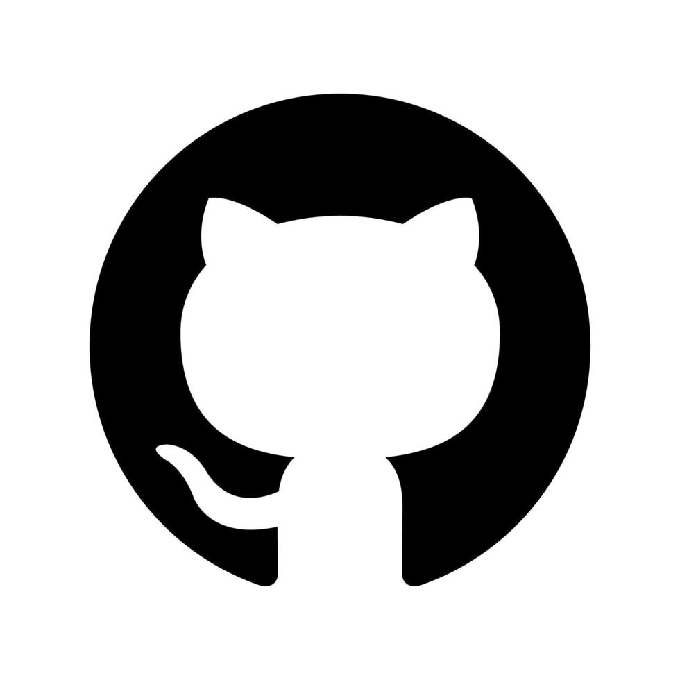

Git is a version control system that intelligently tracks changes in files.

GitHub is a cloud-based platform where you can store, share, and work together with others to write code.

Think of this as email (Git) vs Gmail (GitHub)

## GitHub: Version control {.smaller}

GitHub allows you to create, store, change, merge, and collaborate on files or code. Any member of a team can access the GitHub repository and see the most recent version in real-time. Then, they can make edits or changes that the other collaborators also see.

GitHub also lets users make requests of one another and internally discuss the iterations along the way.

[What is Git](https://git-scm.com/book/en/v2/Getting-Started-What-is-Git%3F)

## GitHub: Version control

Goal for today! 

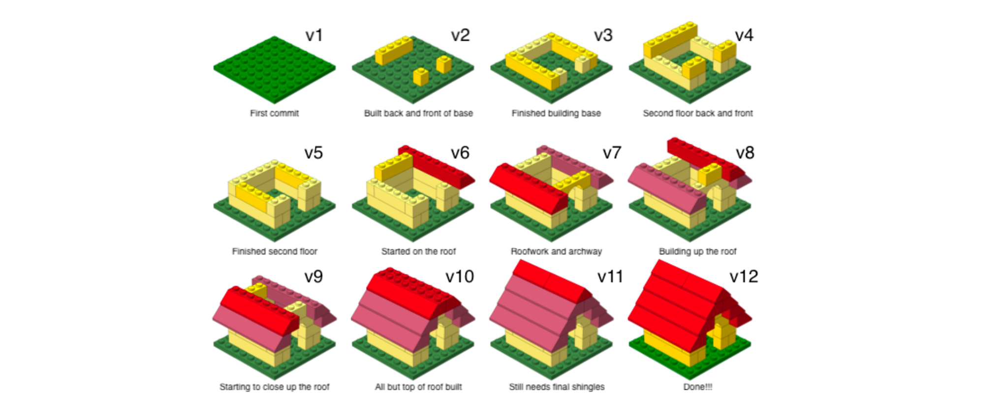

## Clone a repo (SSH Key)

You created a SSH Key. What is that again exactly?

SSH stands for "Secure Shell" and it helps prove authorization. 

## SSH Key

Your computer has a private key 🔑 (SSH key) — secret, kept only on your computer.

GitHub has your public key — safe to share.

GitHub can use the public key to verify that you possess the corresponding private key.

## SSH Key

private key 🔑  ── proves ownership ──> public key 🔓

                                      |
                                      v
                              "Yep, that's you."
                                      |
                                      v
                              Access repository
                              
                              
## SSH Key 

Imagine you used a password instead:

If your GitHub password were stolen, guessed, etc...  

...someone could potentially log into your GitHub account.

Why might this be a bad thing?

## SSH Key 

-- Security ✔

-- Convenience 

If you use HTTPS, it will ask you to set up a personal access token, and you will have to prove you are authorized to access your GitHub repo by typing in your password every single time

## SSH Key 

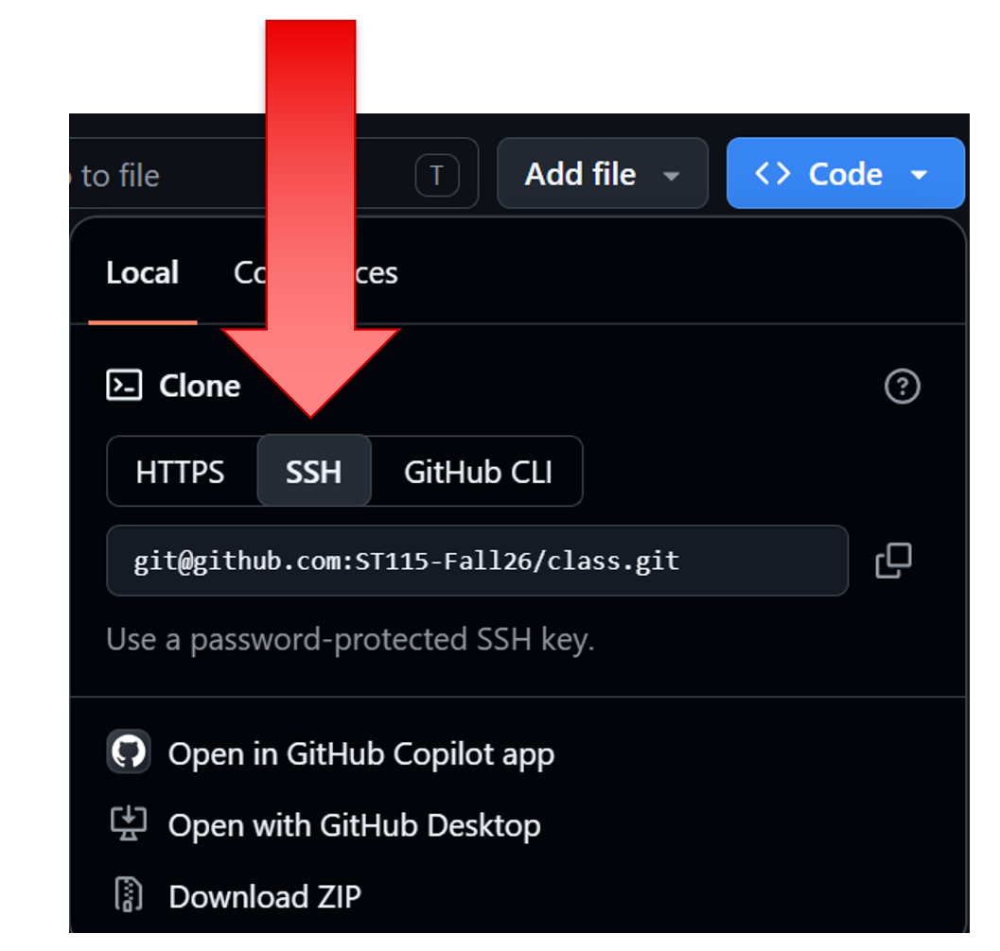

# Questions 

## Before we clone (~2-minutes)

Make sure you have... 

-- A file structure you are confident in (ex. have a Repos Folder)

-- Make sure your new Folder has no spaces in the name (spaces can be seen as separators)

## Clone a Repo 

We are going to again do this together! I want to make sure we are all on the same page.

All of your repos I create for you will be here: <https://github.com/orgs/ST115-Fall26/repositories>

## GitHub Exercises 

Click pull. What happens? Why?

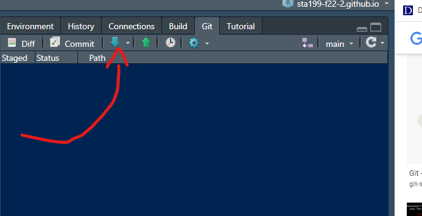

## Terminal 

The terminal is a program where you can control your computer by typing commands instead of clicking buttons.

Think of it as a text-based way to talk to your computer.

The terminal helps you understand what you're actually asking Git to do.

The terminal is like talking directly to Git. 

Try typing this: `git pull` 

## Terminal 

`git pull` 

"Git, go to the repository I'm currently in, check GitHub for new changes, and bring those changes onto my computer."

# Questions 

## GitHub Exercise 

-- Make a `.qmd` file 

-- Save it 

-- Check your Git tab and see what happens 

-- Why do you think this happened? What's going on?

## GitHub Exercise 

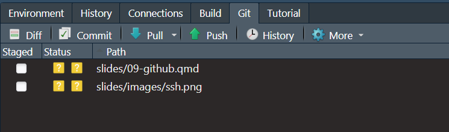

## GitHub Vocab 

In Git, a commit is basically a saved snapshot of your project at a particular point in time.

This is the point of version control! 

Let's commit your .qmd file up to your GitHub repo! 

## Git Commit 

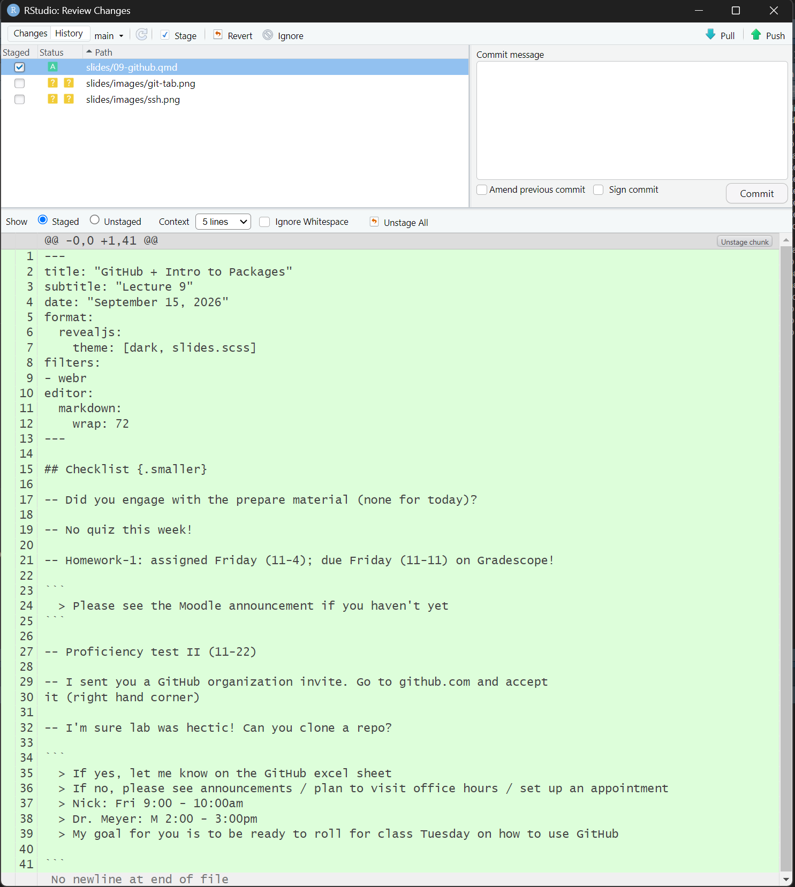

## Terminal 

`git add -A`

This will stage all of your changes! 

In Git, “stage” means selecting the changes you want to include in your next commit.


## GitHub Exercise 

Let's put a message! 

-- Make it short 

-- Make it informative 

-- ... plus I can see it ... 

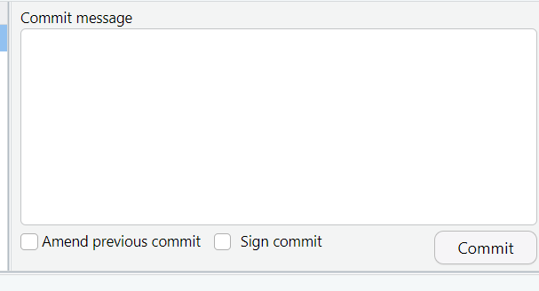

Click Commit. What happens?

## Branch 

What does this mean?


## GitHub Exercise 

-- Click Push 

-- What happens? 

-- Check your repo!

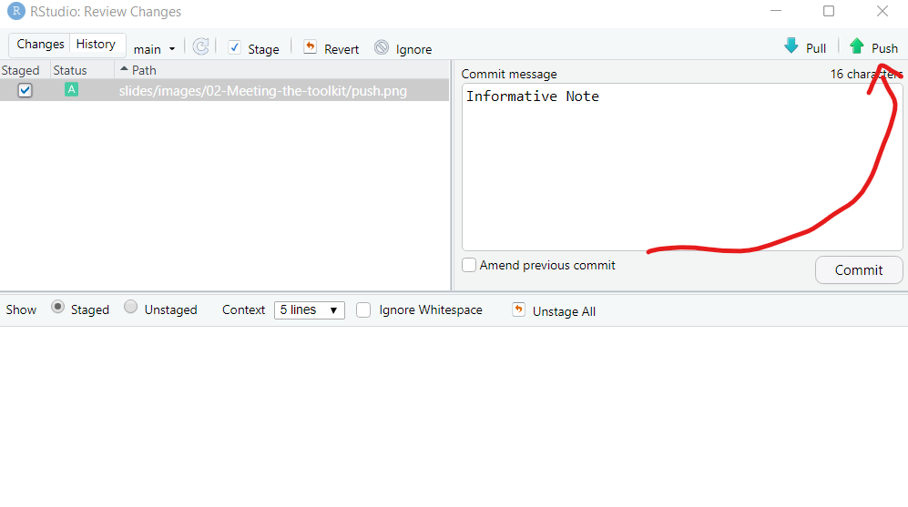

## Terminal 

`git commit -m "Describe what you changed"`

`git push`

## Terminal Story 

`git add -A`

`git commit -m "Update data analysis"`

`git push`

# Questions 

## On your own 

-- Make a code chunk 

-- Type in some equation 

-- Render your document 

-- Push your changes 

# More GitHub Stuff

## See these changes on GitHub 

Go to your repo on GitHub and click your last commit message. What do you see?

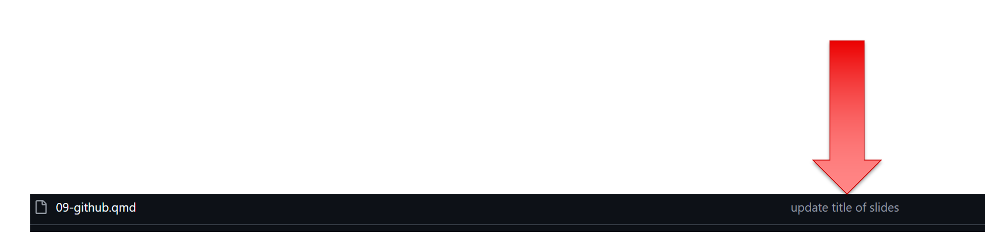

## GitHub Exercise 

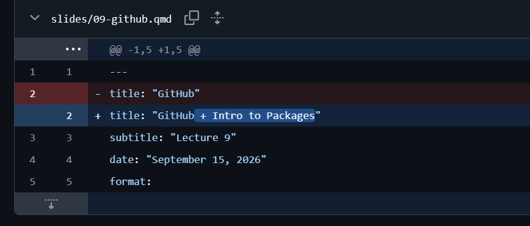


## Go Back 

`git restore filename` - This discards your uncommitted changes to that file.

## Go Back 

`git log --oneline` 

Note: press q to return the terminal to a place where it allows you to type

`git revert #####`

## Example 

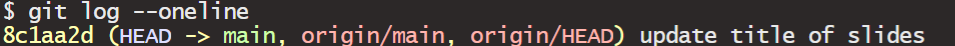

`git revert 8c1aa2d`

## Note 

Git may have opened a text editor rather than the commit history itself. 

This can happen because Git sometimes opens an editor when it needs you to enter or edit a commit message.

Simply close the text editor and the change will take place. 

Note: Because your file changed, it will close your file and you will have to re-open it on your computer. 

# Questions 

# Packages

## Packages

Think of R itself as a basic toolbox. Packages are like specialized toolkits that you can add when you need them.

There are two steps you need to remember with packages: 

-- `install.packages()`

-- `library()` 

## Packages 

Most of the time, you install R packages from CRAN, which stands for the Comprehensive R Archive Network.

You don't usually have to visit a website yourself. R can download the package for you.

[CRAN](https://cran.r-project.org/)

## Packages Exercise 

Click on the Packages tab in RStudio... 

... what do you notice? 

## We want more packages 

We are going to download the `dplyr` package from CRAN. Let's do it together! But first, let's try and run this code! I promise it works... 

```{r}
#| echo: true
#| eval: false
filter(iris, Petal.Length <= 1.1)
```

## Demo 

Go to the Packages tab and un-check `dplyr`

Next, run the following two sets of code, independently from each other. What do you notice?

```{r}
#| echo: true
#| eval: false
x <- c(10, 20, 30, 40, 50)

filter(x, rep(1/3, 3))
```

```{r}
#| echo: true
#| eval: false
library(dplyr)

x <- c(10, 20, 30, 40, 50)

filter(x, rep(1/3, 3))
```

## Demo 

Does this work? What's going on?

```{r}
#| echo: true
#| eval: false
library(dplyr)

x <- c(10, 20, 30, 40, 50)

stats::filter(x, rep(1/3, 3))
```


## Takeaway 

-- You only need to install the package once 

-- You need to load the package every time you open a new session 

-- If it's a one-off, you don't need to load the entire package! 

-- Packages have help files! 

Let's take a look at the help file for `dplyr`

# Questions 

# Create your own GitHub repo (if time)

