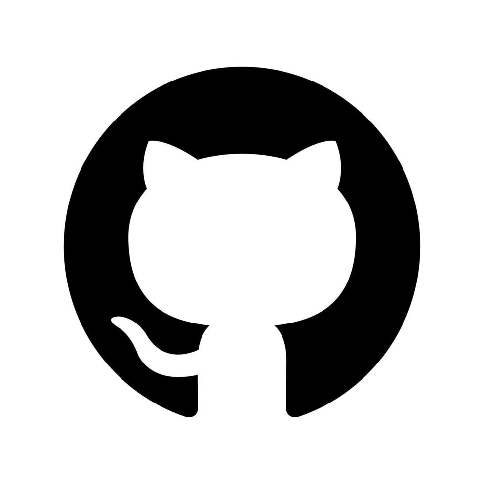
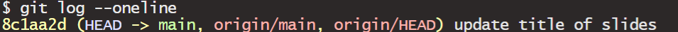

## Checklist {.smaller}

-- Did you engage with the prepare material (none today)

-- Moodle quiz this week (due Friday at 11:59pm)

-- Homework-1: assigned Friday (9-18); due Friday (9-25) on Gradescope!

-- Proficiency test II (9-22)

-- Go to the following website and favorite it: <https://github.com/orgs/ST115-Fall26/repositories>

      > do you see a github-practice repo with your name attached?
      > If yes, great!
      > If not, please let me know after class

-- Clone the *more-github-practice* repo from our organization page!
      
## Proficiency test II (9-22){.smaller}

-- Clone a repo 

-- Do stuff in the repo

      > for loop
      > Function writing 
      > Packages
      
-- Have at least three **meaningful** commit messages (one after each task)

Same resources as last time (full sheet of hand-written notes)

## Proficiency test II (9-22){.smaller}

Questions are encouraged!

      > Getting an error outside the scope of this course (uncommon; Nick will help)
      > Getting an error that you should know how to fix (Nick will not help)
      
If you can't get code to run...

      > You can still show your work by using code chunk arguments to stop the code from evaluating
      
Turn in PDF on Gradescope by end of lab.

## Proficiency test II (9-22){.smaller}

I will create you a repo within the organization called *Proficiency practice* today

You will have a *proficiency-test-II* repo for the test in our organization, Tuesday

If you can not clone a repo, you can still earn partial points on the test by completing tasks, and turning in the test

*Your lowest score will be dropped* 

# Questions 

## Warm up

-- Pull 

-- Stage 

-- Commit 

-- Push 

In GitHub, how can we define each of these processes? 

## Warm up

-- Pull - take every file in the repo and *pull* it to your local computer

-- Stage - choose which changes you want to include in your next commit.

-- Commit - **save** the changes you have staged

-- Push - *push* them up to your repo 

## Warm up 

Go to Moodle and download the jpg file from the Week-5 section. 

-- Upload this directly to GitHub

-- Practice pulling it down locally!

## Tips 

As we learn GitHub, staging, committing, and pushing **everything** is often a good habit because it keeps the local project and the GitHub repository synchronized.

## Out of sync 

When you are out of sync, you can create something called a **merge conflict**. These are less common when you are the only one working on the project, but it can happen!

A merge conflict happens when Git tries to combine changes from two versions of a file that contain conflicting edits.

What does this look like? 


## Merge conflict 

GitHub:        A

Computer:      A

## Merge conflict

You edit your .qmd file and changed "This project analyzes student performance." to "This project analyzes student achievement."

Computer:      A → B

GitHub:        A

## Merge conflict

You edit your .qmd file on a DIFFERENT computer/DIRECTLY in GitHub and changed "This project analyzes student performance." to "This project analyzes student outcomes."

Computer:      A → B

GitHub:        A → C


## Merge conflict

Not staging all changed files → repositories may become out of sync.

Conflicting changes to the same parts of a file → potentially a merge conflict.

## The flow 

git pull

   ↓
   
Work/render
   
   ↓
   
git add -A (terminal)
   
   ↓
   
Commit (with a message)
   
   ↓
   
Push

# Questions 

## More practice 

-- Answer the task question 

-- Render 

-- Stage 

-- Commit (with a message)

-- Push 

-- Check out your repo!


# Questions 

## Takeaway 

-- What is Git and GitHub?

-- Why should we use Git/GitHub as statisticians?

-- Why did we have to set up a SSH key?

-- What does interacting with GitHub look like? 

# Creating your own repo 

## Creating your own repo 

I can make repos for you because you are part of a ST-115 organization. In the future, you will create your own repos for your collaborative projects!

-- How to make them

-- What some of the settings mean 

-- How to invite people!

# Questions

# Packages

## Packages

Think of R itself as a basic toolbox. Packages are like specialized toolkits that you can add when you need them.

There are two steps you need to remember with packages: 

-- `install.packages()`

-- `library()` 

## Packages 

Most of the time, you install R packages from CRAN, which stands for the Comprehensive R Archive Network.

You don't usually have to visit a website yourself. R can download the package for you.

[CRAN](https://cran.r-project.org/)

## Packages Exercise 

Click on the Packages tab in RStudio... 

... what do you notice? 

## We want more packages 

We are going to download the `dplyr` package from CRAN. Let's do it together! But first, let's try and run this code! I promise it works... 

```{r}
#| echo: true
#| eval: false
filter(iris, Petal.Length <= 1.1)
```

## Demo 

Go to the Packages tab and un-check `dplyr`

Next, run the following two sets of code, independently from each other. What do you notice?

```{r}
#| echo: true
#| eval: false
x <- c(10, 20, 30, 40, 50)

filter(x, rep(1/3, 3))
```

```{r}
#| echo: true
#| eval: false
library(dplyr)

x <- c(10, 20, 30, 40, 50)

filter(x, rep(1/3, 3))
```

## Demo 

Does this work? What's going on?

```{r}
#| echo: true
#| eval: false
library(dplyr)

x <- c(10, 20, 30, 40, 50)

stats::filter(x, rep(1/3, 3))
```


## Takeaway

-- When do we install packages?

-- When do we library packages?

-- When might using :: be useful?

## Takeaway 

-- You only need to install the package once 

-- You need to load the package every time you open a new session 

-- If it's a one-off, you don't need to load the entire package! 

-- Packages have help files! 

# if time 

## More GitHub 

These will NOT be on the proficiency test II. These are more advanced GitHub topics that I hope we slowly work into your workflow thorughout the semester + beyond. 



## Go Back 

`git restore filename` - This discards your uncommitted changes to that file

Let's demo this!

## Go Back 

`git log --oneline` 

Note: press q to return the terminal to a place where it allows you to type

`git revert #####`

## Example 



`git revert 8c1aa2d`

Let's demo this!

## Note 

Git may have opened a text editor rather than the commit history itself. 

This can happen because Git sometimes opens an editor when it needs you to enter or edit a commit message.

Simply close the text editor and the change will take place. 

Note: Because your file changed, it will close your file and you will have to re-open it on your computer. 

      