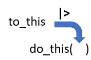
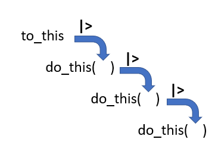

## Checklist 

-- No quiz this week

-- Homework-2 is due on the 25th via Gradescope 

-- Please see the prepare material for Tuesday if you haven't. Thank you for your flexibility!

-- Please clone the wrangling-I repo, and have this ready to go! 

-- Wellness day next Tuesday!

## Warm-up 

Where to make vs not make repos!


## tidyverse

::: columns
::: {.column width="40%"}
{width="400" height="300" fig-align="left"}
:::

::: {.column width="60%"}
-- The **tidyverse** is a collection of R packages designed for data science.

-- All packages share an underlying philosophy and a common grammar.
:::
:::

## tidyverse

You can check out the website for more information on the Tidyverse + each of the packages!

[tidyverse](https://tidyverse.org/)

## On your own 

Let's install the `tidyverse` on your computer

Next, load up the package. See the output. What happened? What did you notice>

## tidyverse

The `tidyverse` acts as a *metapackage* or *umbrella* package. No function strictly comes from the tidyverse package uniquely. The purpose of the tidyverse is to house/group similar packages together.... and when you open the tidyverse, you get all of these packages! 

## tidyverse pipe 

`|>` is called a pipe operator 

This is used to emphasize a sequence of coding actions

"and then"

## The tidyverse pipe



## The tidyverse pipe



## Compare{.smaller}

```{r}
#| message: false
library(tidyverse)

glimpse(mtcars)
```

## vs{.smaller}

```{r}
#| message: false

library(tidyverse)

mtcars |>
  glimpse()
```


## the pipe{.smaller} 

The pipe operator also works outside of the `tidyverse` 

However, the `tidyverse` language was built to best support this type of syntax! 

```{r}
iris |>
  summary()
```

# Questions 

## Goals for activity 

-- GitHub practice

-- README

-- Tibble vs Data Frame 

-- Pipe practice 

-- Start wrangling data using `dplyr` functions 

-- Commenting code 

-- Understand **when** you could/should use these functions to accomplish an objective

