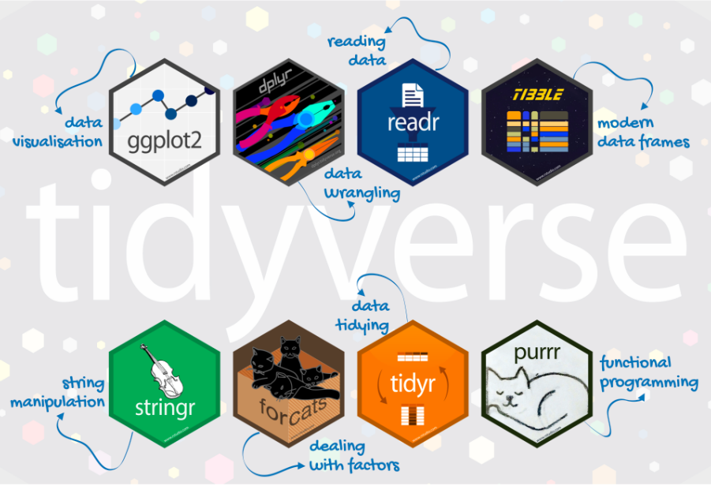
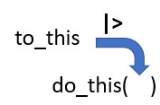
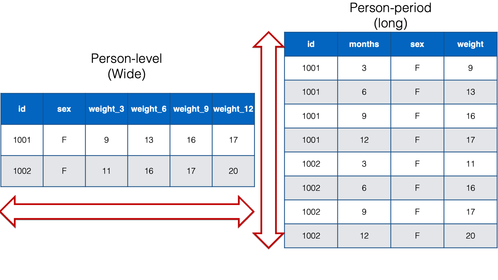
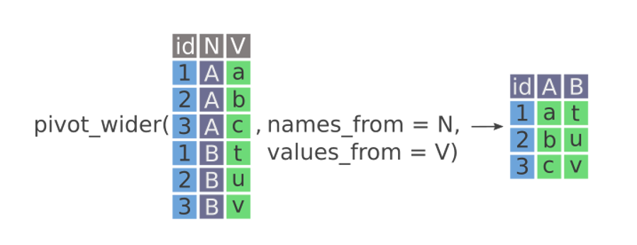

## Checklist{.smaller} 

-- Quiz released Monday (due Friday at 11:59pm)

-- Solutions for everything are posted. Please see the website (on our schedule page)

-- Please open up your `wrangling` project. You can also clone your `pivot-practice` repo created for you

-- Proficiency Test III (October 6th)

-- Midterm-1 (October 13th in-class)

## Proficiency Test II 

Extra Credit Opportunity 

-- The commit criteria has been turned into EC because of the GitHub error in repo creation

-- + 2 if you followed a decent GitHub workflow 

-- + 0 if you did not

## Proficiency Test III 

Same story as the first two 

-- You will have a created repo for you to clone 

-- 50-minutes to complete 3/4 tasks 

-- Full sheet of notes 

-- Cumulative with emphasis on material after proficiency test II 

-- I'll continue to make a Moodle announcement outlining exactly what to expect 

## Midterm-I 

You will NOT do any live coding during Midterm-1

My goal is to test your conceptual understanding around R/RStudio, Quarto, GitHub

You will NOT have to write lines and lines of code (you may have to write a line or two of code to answer a specific question)

## Example Question 

-- Define pull/stage/commit/push as they are related to the GitHub workflow process

-- Explain why `View()` should not go in a .qmd file 

-- Explain the difference between `library()` and `install.packages()`

## Example Question 

Don't assume any other code has been run when answering this question. There are four errrors below using the `mtcars` data set, preventing the code from running. Identify them. 

```{r}
#| eval: false 
#| echo: true 

Mtcars |> 
  filter(mpg > 20)
  select(mpg cyl disp)
```

# Questions 

## Warm-up 

-- What is the `tidyverse`? 

-- What is the |> ? 

## tidyverse 

::: columns
::: {.column width="40%"}
{width="400" height="300" fig-align="left"}
:::

::: {.column width="60%"}
-- The **tidyverse** is a collection of R packages designed for data science.

-- All packages share an underlying philosophy and a common grammar.
:::
:::

## tidyverse pipe 

`|>` is called a pipe operator 

This is used to emphasize a sequence of coding actions

"and then"

## The tidyverse pipe



## Last time 

Introduced the `flights` data set in the `nycflights13` pacakge.

Worked up through `select()`

Open the project + load the packages. Re-familiarize yourself with the data set, and we will pick back up with `slice()`! 

# Questions 

# Forms of Data

## Data Format (Wide vs Long){.smaller}

**Wide** data contains values that do not repeat in the first column (short-cut definition for most situations)

Wide data are data in which multiple values of a variable (often measurements taken under different conditions or at different times) are stored in separate columns rather than in separate rows.

**Long** data contains values that do repeat in the first column (short-cut definition for most situations)

Long data are data in which multiple measurements of the same observational unit are stored in separate rows, with one or more columns identifying the measurement or condition associated with each row.

## Data Format (Wide vs Long)

{width="950" height="450" fig-align="center"}

## Data Format (Wide vs Long)

Let's open the `pivot-practice` project for some motivation on which we might prefer to work with! 

{width="950" height="450" fig-align="center"}

## Tidy Data

There are three interrelated rules that make a dataset tidy:

-   **Each variable is a column; each column is a variable.**

-   **Each observation is row; each row is an observation.**

-   Each value is a cell; each cell is a single value.

## Data Example{.smaller} 

| Student | Math_2025 | Math_2026 | Science_2025 | Science_2026 |
|---------|-----------|-----------|--------------|--------------|
| A       | 85        | 90        | 88           | 92           |
| B       | 78        | 82        | 91           | 89           |
| C       | 92        | 95        | 85           | 87           |

-- Wide or Long?

-- Tidy?

## Data Example 

This is wide data because each student occupies one row, with separate columns for each measurement.

It is not tidy if the variables of interest are Student, Subject, Year, and Score, because Subject and Year are combined in the column names.

## Data Example{.smaller} 

| Student | Measurement | Value |
|---------|-------------|-------|
| A       | Math_2025   | 85    |
| A       | Math_2026   | 90    |
| A       | Science_2025| 88    |
| A       | Science_2026| 92    |
| B       | Math_2025   | 78    |
| B       | Math_2026   | 82    |
| B       | Science_2025| 91    |
| B       | Science_2026| 89    |
| C       | Math_2025   | 92    |
| C       | Math_2026   | 95    |
| C       | Science_2025| 85    |
| C       | Science_2026| 87    |

## Data Example{.smaller}

| Student | Subject | Year | Score |
|---------|---------|------|-------|
| A       | Math    | 2025 | 85    |
| A       | Math    | 2026 | 90    |
| A       | Science | 2025 | 88    |
| A       | Science | 2026 | 92    |
| B       | Math    | 2025 | 78    |
| B       | Math    | 2026 | 82    |
| B       | Science | 2025 | 91    |
| B       | Science | 2026 | 89    |
| C       | Math    | 2025 | 92    |
| C       | Math    | 2026 | 95    |
| C       | Science | 2025 | 85    |
| C       | Science | 2026 | 87    |

## More Motivation

Let's jump into the pivot practice and see what type of data we are working with!

## pivots

-- `pivot_longer`

-- `pivot_wider`

# pivot_wider

## pivot_wider{.smaller}

-- Making tables for quick comparison / display purposes

-- `names_from`

-- `values_from`

{width="950" height="500" fig-align="center"}

# pivot-practice

## pivot-practice{.smaller}

```{r}
WorldPhones
```


This is wide data because each year occupies one row, and each continent has its own column containing its measurement.

