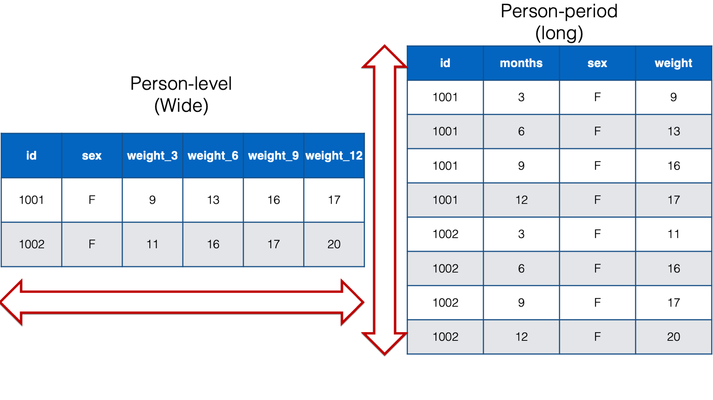
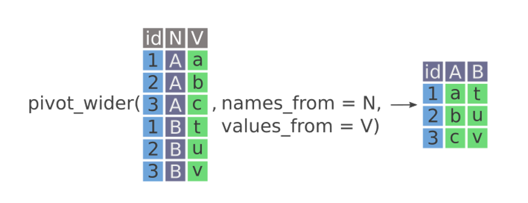
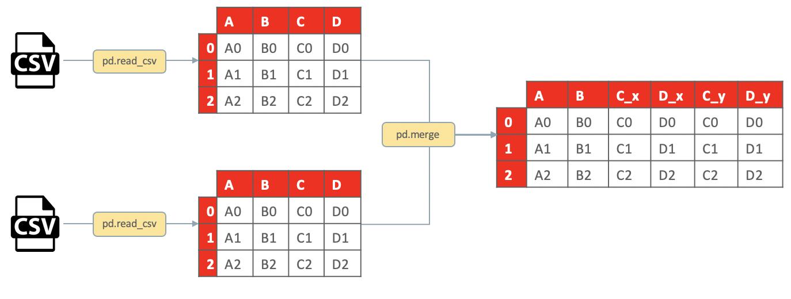
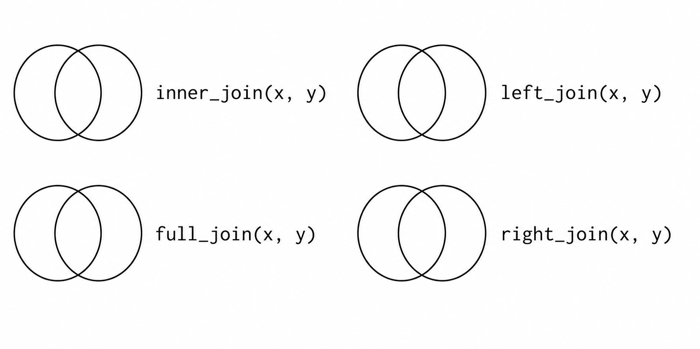
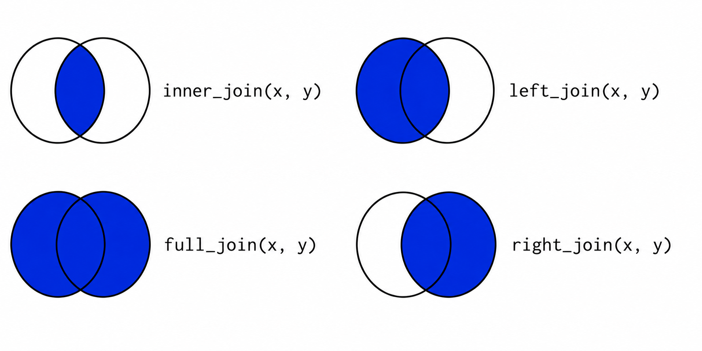

## Checklist {.smaller}

-- Quiz released Monday (due Friday at 11:59pm)

-- Solutions for everything are posted. Please see the website (on our
schedule page)

-- Please open up your `pivot-practice` project. You can also clone your
`joins` repo created for you. We may even get to the `data-types` repo!

-- Midterm-1 (October 13th in-class)

-- Proficiency II is posted. Please see solutions. Re-grade requests are
due by Friday at 5:00pm

-- The Statistics Experience is LIVE!

## Midterm-1

You will NOT do any live coding during Midterm-1

My goal is to test your conceptual understanding around R/RStudio,
Quarto, GitHub

There will be no additional resources used when taking the exam. The
exam is designed to test your fundamental understanding of code/coding
concepts, vs designed to have you look up / need additional resources to
answer the questions.

You will NOT have to write lines and lines of code (you may have to
write a line or two of code/fill in the blank to answer a specific
question)

## General Study Tips {.smaller}

-- Do you understand GitHub (not just the motions)?

-- Do you understand the fundamental pieces of RStudio?

-- Can you explain code? Can you catch errors?

-- Can you look at code and anticipate results?

-- Can you explain coding concepts (ex. packages; where to put code
when; etc.)

-- Do you know common function definitions (ex. mutate, ifelse, etc.)?

## General Study Tips

Go back to our coding exercises and ask yourself *why*

Read/watch the prepare material to make sure that you fundementally
understand the concepts

# Questions

## Last time

We talked about wide vs long data

-- What is wide data?

-- What is long data?

## Data Format (Wide vs Long) {.smaller}

**Wide** data contains values that do not repeat in the first column
(short-cut definition for most situations)

Wide data are data in which multiple values of a variable (often
measurements taken under different conditions or at different times) are
stored in separate columns rather than in separate rows.

**Long** data contains values that do repeat in the first column
(short-cut definition for most situations)

Long data are data in which multiple measurements of the same
observational unit are stored in separate rows, with one or more columns
identifying the measurement or condition associated with each row.

## Data Format (Wide vs Long)

{width="950" height="450"
fig-align="center"}

## pivots

What do we think these functions do?

-- `pivot_longer()`

-- `pivot_wider()`

## pivot_wider {.smaller}

-- Making tables for quick comparison / display purposes

-- `names_from`

-- `values_from`

{width="950" height="500" fig-align="center"}

# pivots project

# Do you plan to only work with one data set at a time?

## Messy data

-- The sheer volume of information is sometimes referred to as "messy"
data, because it's hard to make sense of it all.

## Messy data

{width="950" height="550"
fig-align="center"}

# How?

## Joining datasets

**Data merging** is the process of combining two or more data sets into
a single data set. Most often, this process is necessary when you have
raw data stored in multiple files, worksheets, or data tables, that you
want to analyze together.

## Joining datasets

-- Left Join

-- Inner Join

-- Right Join

-- Full Join

## Joining datasets

As you go through this exercise in the `joins` project, I want you to
shade in the venn diagrams accordingly.

{width="950" height="500" fig-align="center"}

# Solutions

## Joining datasets

{width="950" height="500" fig-align="center"}

# Questions

# Data Types

## Data Types

Let's now pull up the `data-types` project.

Why does understanding data types matter?

## Data Types

`typeof()` — how is it stored?

`class()` — how should R treat it?

We will focus on `class()` for our activity!

## Data Types {.smaller}

| Class        | What it represents    | Example                  |
|--------------|-----------------------|--------------------------|
| `numeric`    | Numbers               | `10.5`, `55`             |
| `integer`    | Whole numbers         | `55L`                    |
| `character`  | Text                  | `"hello"`                |
| `logical`    | `TRUE` / `FALSE`      | `TRUE`                   |
| `complex`    | Complex numbers       | `3 + 2i`                 |
| `factor`     | Categorical data      | `factor(c("A", "B"))`    |
| `Date`       | Calendar dates        | `as.Date("2026-10-07")`  |
| `POSIXct`    | Date + time           | `Sys.time()`             |
| `data.frame` | Tabular data          | `mtcars`                 |
| `matrix`     | 2D array of one type  | `matrix(1:6, 2, 3)`      |
| `list`       | Collection of objects | `list(1, "hello", TRUE)` |

The "basic" data types refer to the top 6

## How to change data types {.smaller}

| Desired type | Typical conversion |
|--------------|--------------------|
| numeric      | `as.numeric()`     |
| integer      | `as.integer()`     |
| complex      | `as.complex()`     |
| character    | `as.character()`   |
| logical      | `as.logical()`     |
| factor       | `factor()`         |

Note: `factor()` is the more commonly used and more flexible approach
because you can specify things like the levels, vs `as.factor()`

## Type coercion

Can we have more than one data type in a list?

Can we have more than one data type in a vector?

## Type coercion

When you combine values into a vector with c(), R must make all elements
the same type.

Type coercion is the automatic conversion of data types from one to
another.

# Let's explore!

## General Rule

R generally coerces toward a more flexible type

logical → integer → numeric → character

... and sometimes, coercion isn't always possible!

```{r}
#| eval: false
as.numeric("hello")

# NA
```

# Questions

# See you Tuesday!
