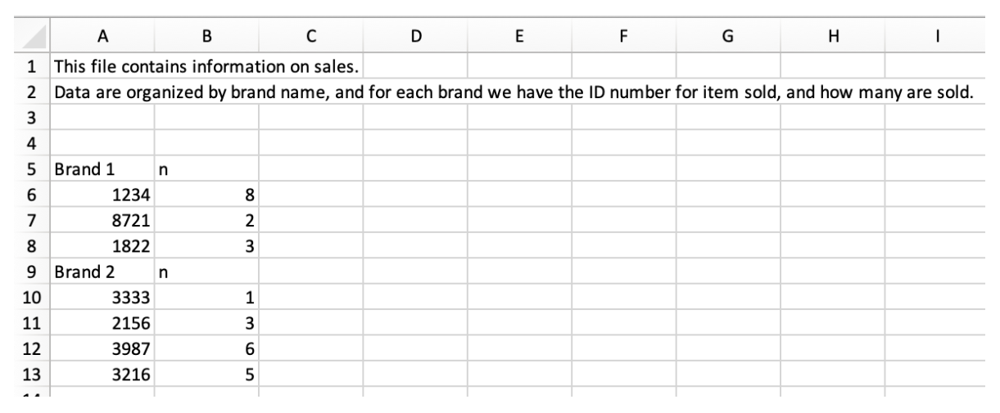
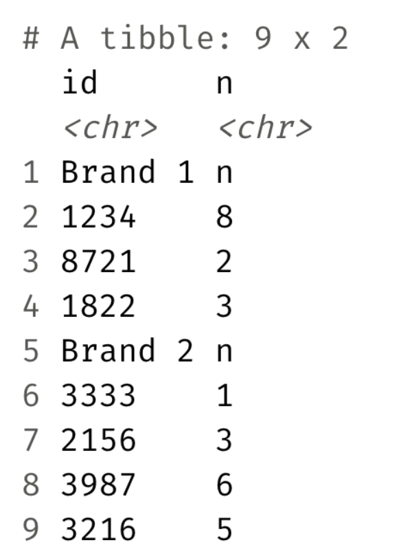

## Checklist {.smaller}

-- Please open up your `data-types` project. You can also clone your
`data-import` repo created for you.

-- Congrats on surviving Midterm-1! Grades by the end of next week (probably sooner)

-- The Statistics Experience is LIVE!

## Data Types

Let's now pull up the `data-types` project.

Why does understanding data types matter?

## Data Types

`typeof()` — how is it stored?

`class()` — how should R treat it?

We will focus on `class()` for our activity!

## Data Types {.smaller}

| Class        | What it represents    | Example                  |
|--------------|-----------------------|--------------------------|
| `numeric`    | Numbers               | `10.5`, `55`             |
| `integer`    | Whole numbers         | `55L`                    |
| `character`  | Text                  | `"hello"`                |
| `logical`    | `TRUE` / `FALSE`      | `TRUE`                   |
| `complex`    | Complex numbers       | `3 + 2i`                 |
| `factor`     | Categorical data      | `factor(c("A", "B"))`    |
| `Date`       | Calendar dates        | `as.Date("2026-10-07")`  |
| `POSIXct`    | Date + time           | `Sys.time()`             |
| `data.frame` | Tabular data          | `mtcars`                 |
| `matrix`     | 2D array of one type  | `matrix(1:6, 2, 3)`      |
| `list`       | Collection of objects | `list(1, "hello", TRUE)` |

The "basic" data types refer to the top 6

## How to change data types {.smaller}

| Desired type | Typical conversion |
|--------------|--------------------|
| numeric      | `as.numeric()`     |
| integer      | `as.integer()`     |
| complex      | `as.complex()`     |
| character    | `as.character()`   |
| logical      | `as.logical()`     |
| factor       | `factor()`         |

Note: `factor()` is the more commonly used and more flexible approach
because you can specify things like the levels, vs `as.factor()`

## Type coercion

Can we have more than one data type in a list?

Can we have more than one data type in a vector?

## Type coercion

When you combine values into a vector with c(), R must make all elements
the same type.

Type coercion is the automatic conversion of data types from one to
another.

# Let's explore!

## General Rule

R generally coerces toward a more flexible type

logical → integer → numeric → character

... and sometimes, coercion isn't always possible!

```{r}
#| eval: true
#| echo: true

as.numeric("hello")
```

# Questions

## Importing data 

Up to this point, we have worked data sets in R. Now, we are going to learn different ways to upload your own data! 

## The classic

`read_csv()`

-- in the `readr` package

-- .csv stands for comma separated values

-- When you save an excel file as a `.csv`, it separates values with a ,

## The template 

`data <- read_csv("filename.csv")`

-- It's common to have a data folder to store/reference data 

-- Clone the data import repo
      
      > make a data folder
      > Download the .csv file from Moodle 
      > Read this into R 
      > Check your environment tab to see if things worked! 
      
## Common arguments 

Let's pull up the help file for `read_csv()` and look at common arguments. What do these do / how could these be useful for us?

-- `col_names =`

-- `skip = `

## Other data

Please visit the following website: <https://www4.stat.ncsu.edu/~online/datasets/bankData.txt>

-- You can read in data stored on public facing websites (like GitHub) by using the url as the filepath

      > I'll make a short write up about this

-- Do these data look different than the first example?

## read_delim 

Let's pull up the help file for `read_delim()`

## solution{.smaller} 

```{r}
#| eval: false
#| echo: true
bank <- read_delim("https://www4.stat.ncsu.edu/~online/datasets/bankData.txt", 
                   delim = ";", 
                   col_names = TRUE)
```

# Questions

## Nobel winners

A Nobel laureate is a person or organization that receives a Nobel Prize. The term “laureate” comes from the laurel wreaths that were given to victors in ancient Greece. We are going to load in and work with a Nobel laureate data set.

We are going to combine our `dplyr` and `readr` skills in the following activity. 

# Questions

## Sales

What we have



## Sales

What we want 



## Hint 

We have cheatsheets on our website!

<https://st115-fall26.github.io/class/computing-cheatsheets.html>

# Questions

# Enjoy Fall Break!