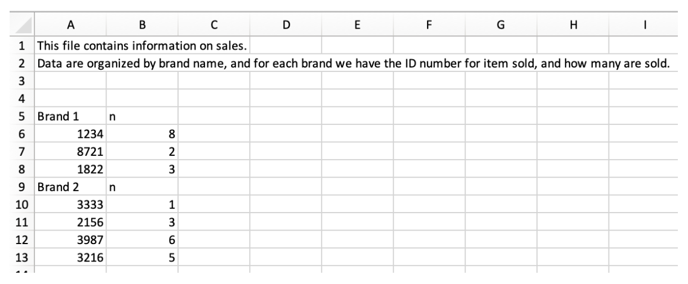
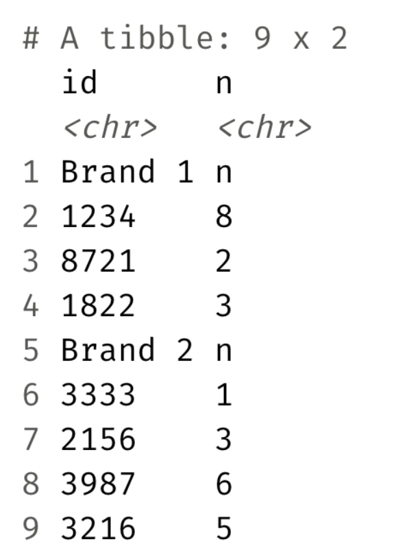
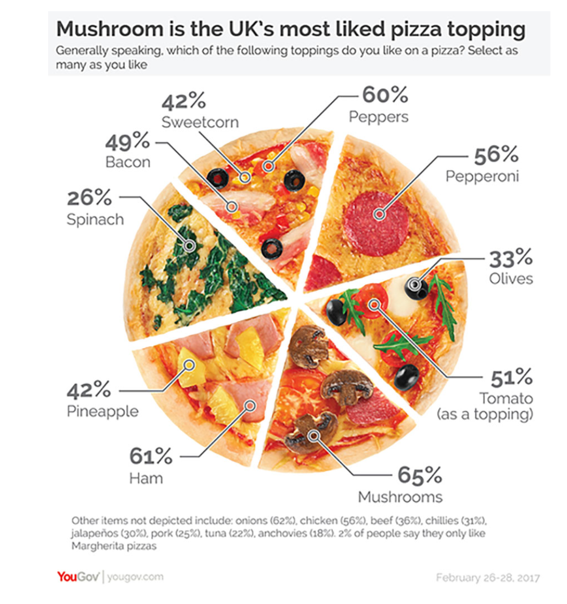
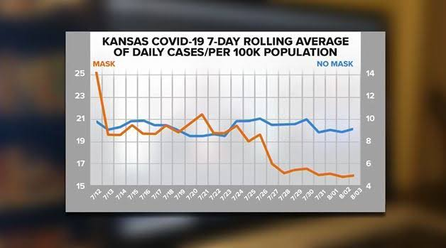
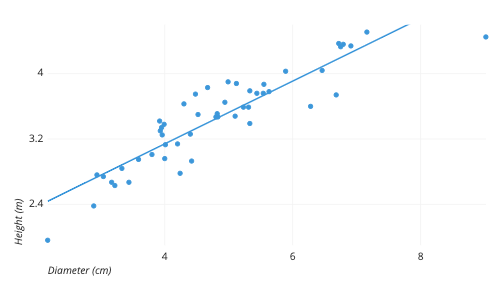
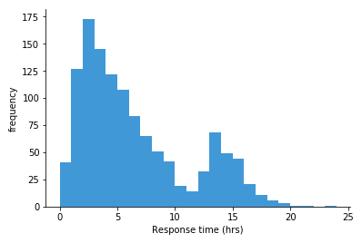
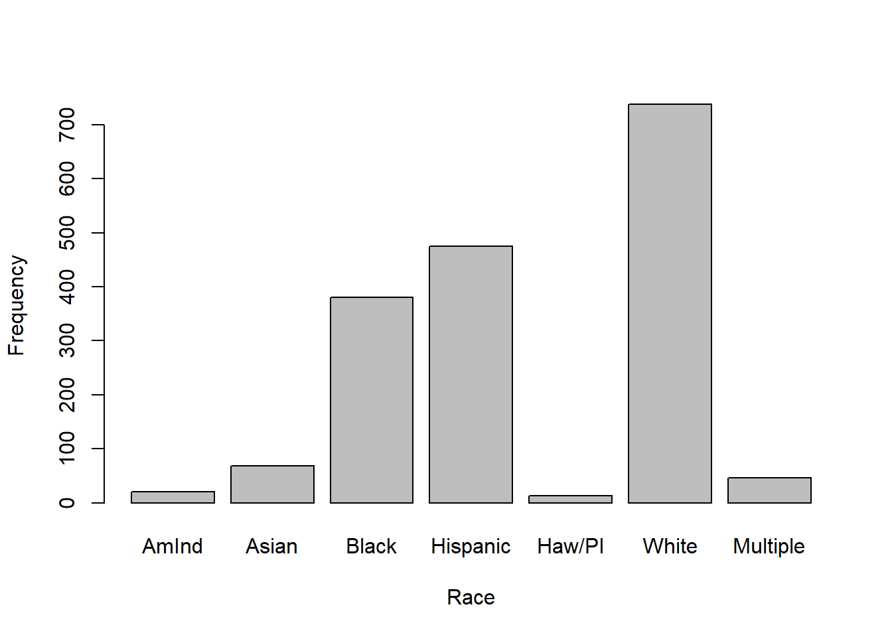
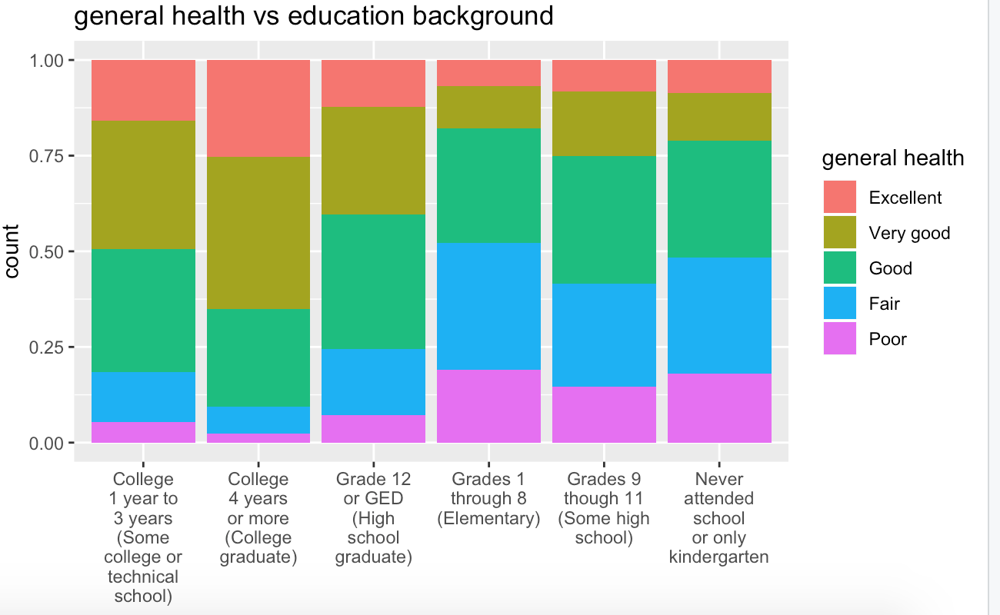
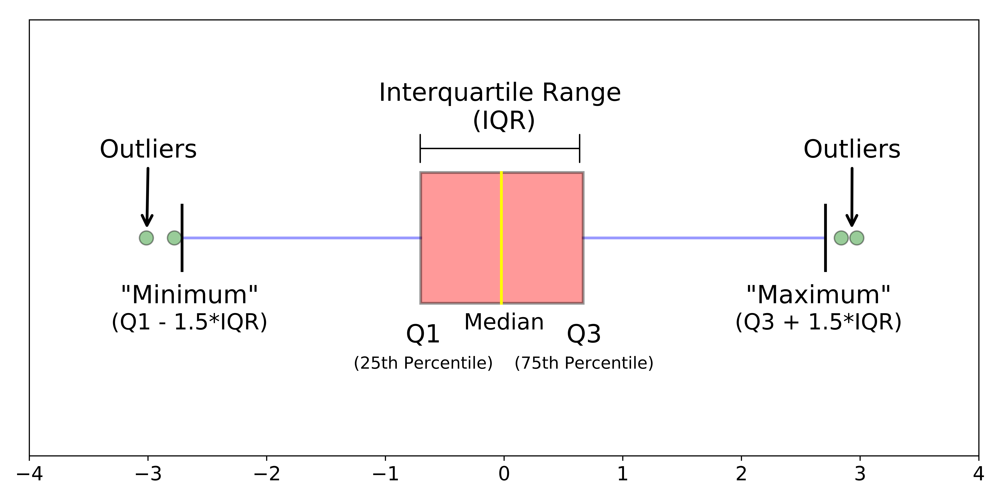

## Checklist {.smaller}

I hope you all had a wonderful Fall Break!

-- Please open up your `data-import` project. You can also clone your
`data-viz` repo created for you.

-- Congrats on surviving Midterm-1! Grades by tonight/tomorrow (solutions are posted)

-- The Statistics Experience is LIVE!

-- Homework-3 next week

-- Proficiency test IV next Tuesday!

## Last time

Last class, we talked at length about the following: 

`typeof()` — how is it stored?

`class()` — how should R treat it?

I want to be as clear as possible around the computing jargon 

## Data types & classes


`typeof()` — how is it stored? - This is known as a data type

`class()` — how should R treat it? - This is known as a data class

## Data Classes {.smaller}

| Class        | What it represents    | Example                  |
|--------------|-----------------------|--------------------------|
| `numeric`    | Numbers               | `10.5`, `55`             |
| `integer`    | Whole numbers         | `55L`                    |
| `character`  | Text                  | `"hello"`                |
| `logical`    | `TRUE` / `FALSE`      | `TRUE`                   |
| `complex`    | Complex numbers       | `3 + 2i`                 |
| `factor`     | Categorical data      | `factor(c("A", "B"))`    |
| `Date`       | Calendar dates        | `as.Date("2026-10-07")`  |
| `POSIXct`    | Date + time           | `Sys.time()`             |
| `data.frame` | Tabular data          | `mtcars`                 |
| `matrix`     | 2D array of one type  | `matrix(1:6, 2, 3)`      |
| `list`       | Collection of objects | `list(1, "hello", TRUE)` |

## How to change data types {.smaller}

| Desired type | Typical conversion |
|--------------|--------------------|
| numeric      | `as.numeric()`     |
| integer      | `as.integer()`     |
| complex      | `as.complex()`     |
| character    | `as.character()`   |
| logical      | `as.logical()`     |
| factor       | `factor()`         |

Changing the data type usually changes the class of the R object as well

## Example 

```{r}
#| echo: true
x <- 5L

typeof(x)         
class(x)          
```

## Example

```{r}
#| echo: true
x <- 5L

typeof(as.numeric(x))  # "double"

class(as.numeric(x))   # "numeric"
```


`as.numeric()` changes the underlying storage type, and the resulting object has the corresponding class.

# Questions 

## Warm-up 

What is type coercion?

## Type coercion

Type coercion forces all elements of a vector to share a common underlying type, and understood (class) the same way. 

## Example 

```{r}
#| echo: true
x <- c(TRUE, 2, "hello")

typeof(x)

class(x)

x
```

# Questions 

## Warm-up 

What does `.csv` stand for? What is it?

What is a delimiter?

## Warm-up 

`.csv` stands for comma separated values. 

A delimiter is a character or symbol used to separate pieces of data.

## Other data

Please visit the following website:
<https://www4.stat.ncsu.edu/~online/datasets/bankData.txt>

-- You can read in data stored on public facing websites (like GitHub)
by using the url as the filepath

```         
  > I'll make a short write up about this
```

What is the delimiter for these data?

# Questions

## Nobel winners

A Nobel laureate is a person or organization that receives a Nobel
Prize. The term “laureate” comes from the laurel wreaths that were given
to victors in ancient Greece. We are going to load in and work with a
Nobel laureate data set.

We are going to combine our `dplyr` and `readr` skills in the following
activity.

# Questions

## Sales

What we have



## Sales

What we want



## Hint

We have cheatsheets on our website!

<https://st115-fall26.github.io/class/computing-cheatsheets.html>

# Questions

# Data visulaization 

## Data visualization 

What makes a good data visualization? 

## Rules{.smaller}

[Posit post](https://posit.co/blog/effective-visualizations-for-credible-data-driven-decision-making)

-- Have a clear purpose        
      
      > Why 
      > What
      > Who
      > Where
      
-- Show the data clearly

-- Make the Message Obvious

      > Try not to set text at angle
      > Avoid unnecessary color
      > Only use color when it adds value
      
## Example

```{r}
#| echo: false
#| eval: true

library(tidyverse)

set.seed(115)

lillard <- tibble(
  ppg = pmax(0, round(rnorm(82, mean = 25, sd = 10)))
)

ggplot(lillard, aes(x = ppg)) +
  geom_histogram(
    aes(fill = after_stat((x %/% 5) %% 2 == 0)),
    binwidth = 5,
    boundary = 0,
    color = "black"
  ) +
  scale_fill_manual(
    values = c("TRUE" = "black", "FALSE" = "red"),
    guide = "none"
  ) +
  labs(
    title = "Damian Lillard's Points per Game",
    subtitle = "",
    x = "Points scored in a game",
    y = "Number of games"
  ) +
  theme_minimal()
```

## Example 

[What's Going on in this Graph?](https://www.nytimes.com/column/whats-going-on-in-this-graph])

{width="400" height="400" fig-align="\"center"}

## Examples

{width="400" height="400" fig-align="\"center"}

## Examples 

{width="400" height="400" fig-align="\"center"}

A chart, concerning masks and COVID-19 cases used by Kansas Department of Health and Environment (KDHE) Secretary Dr. Lee Norman.

## Rules

Part-1 

      > The ggplot basics + structure 
      > The Dos and Don'ts of data visulaization 
      > Which plots are appropriate 
      
Part-2 

      > More advanced plotting tools
      > Answering research questions
      
# Plots

## What types of plots can we make?

**Golden Rule** We can only use certain plots depending on the type of data we are working with!

-   Quantitative

-   Categorical

## Pick a plot

What plot is appropriate to graph the following scenarios

::: columns
::: {.column width="50%"}
-- One quantitative variable

-- One quantitative variable; one categorical variable

-- Two quantitative variables

-- One categorical variable

-- Two categorical variables
:::

::: {.column width="50%"}
-- Scatter plot

-- Histogram

-- Bar plot

-- Segmented bar plot

-- Box plot
:::
:::

## Scatter plot

Two quantitative variables

```{r}
#| eval: false
#| echo: false

data |>
  ggplot() +
  geom_point()
```



## Histogram

One quantitative variable



```{r}
#| eval: false
#| echo: false

data |>
  ggplot() +
  geom_histogram()
```

## Bar plot

One categorical variable



```{r}
#| eval: false
#| echo: false

data |>
  ggplot() +
  geom_bar() #or geom_col
```

## Segmented bar plot

Two categorical variables



```{r}
#| eval: false
#| echo: false

data |>
  ggplot() +
  geom_bar()
```

## Boxplot

One quantitative; One categorical

```{r}
#| eval: false
#| echo: false

data |>
  ggplot() +
  geom_boxplot()
```



# How do we make graphs?

## The process

`mtcars`

You want to create a visualization. The first thing we need to do is set up the canvas...

## The process

|     `mtcars |>`
|         `ggplot()`

{width="400" height="400" fig-align="\"center"}

## The process

|     `mtcars |>`
|         `ggplot(`
|         `aes(`
|              `x = variable.name, y = variable.name)`
|                `)`

aes: describe how variables in the data are mapped to your canvas

## The process

`+` "and"

When working with ggplot functions, we will add to our canvus using `+`

## The process

|     `mtcars |>`
|         `ggplot(`
|         `aes(`
|              `x = variable.name, y = variable.name)`
|                `)` +
|         `geom_point()`

## The process

{width="400" height="400" fig-align="\"center"}

# AE

## Recap of AE {.smaller}

-- Construct plots with `ggplot()`.

-- Layers of ggplots are separated by `+`s.

-- Aesthetic attributes of a geometries (color, size, transparency, etc.) can be **map**ped to variables in the data or **set** by the user.

-- Use `facet_wrap()` when faceting (creating small multiples) by one variable and `facet_grid()` when faceting by two variables.

