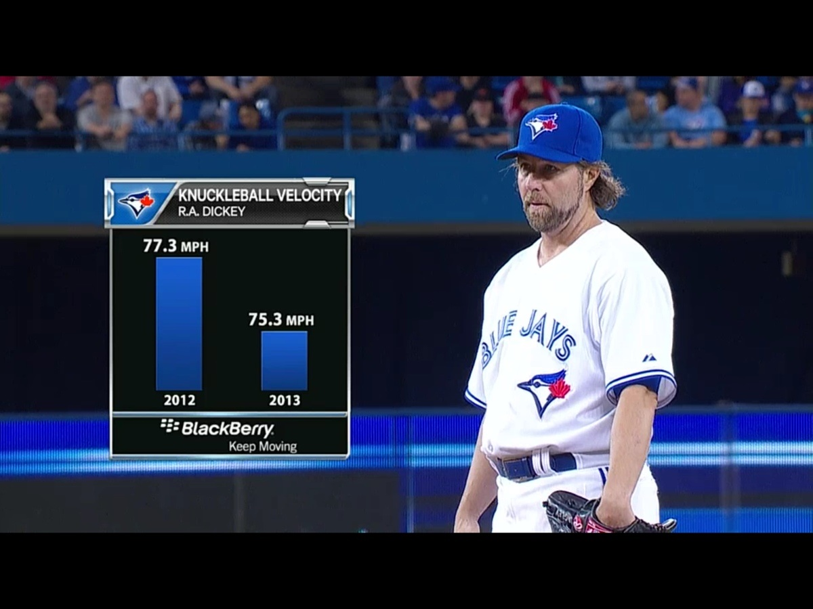
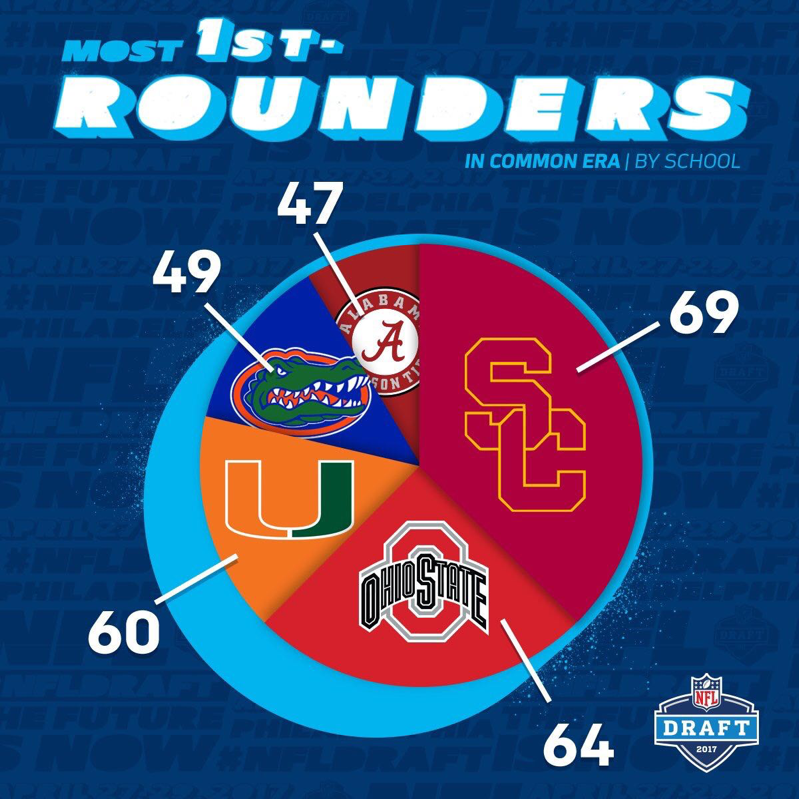
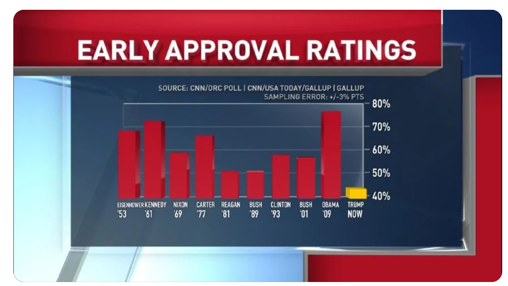
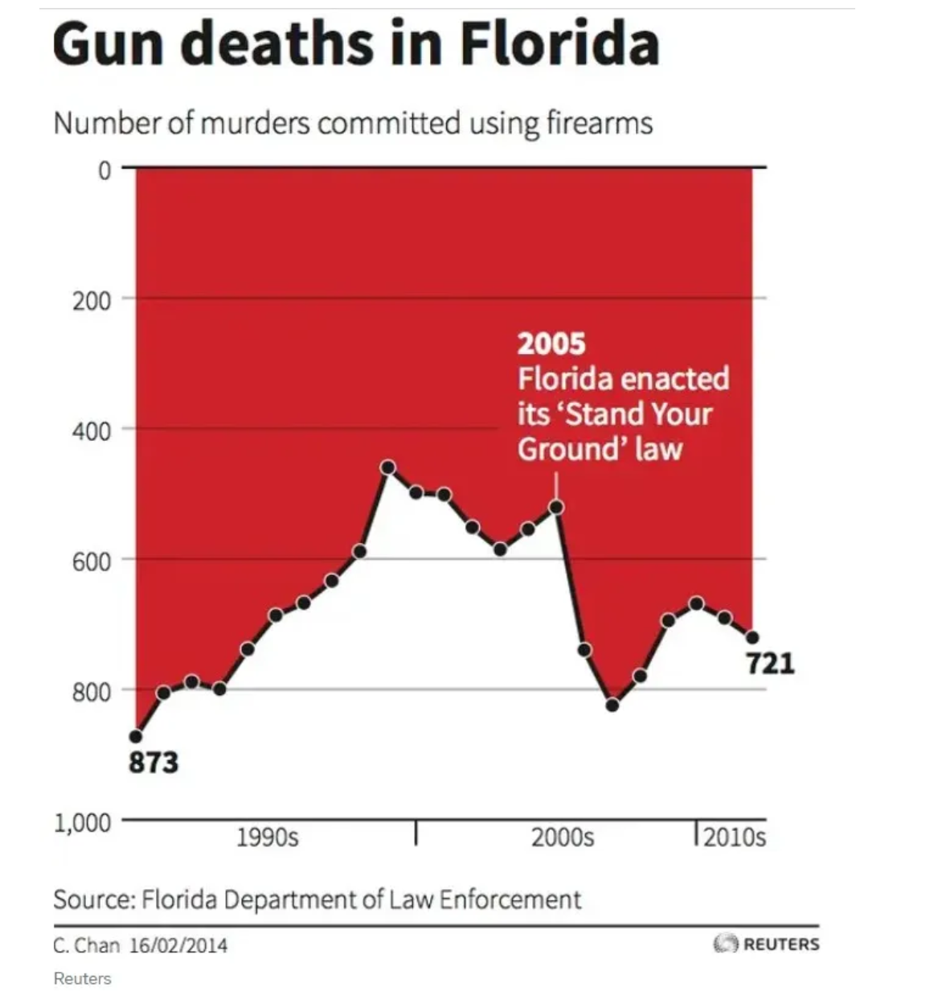
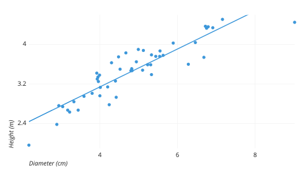
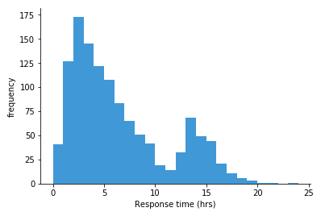
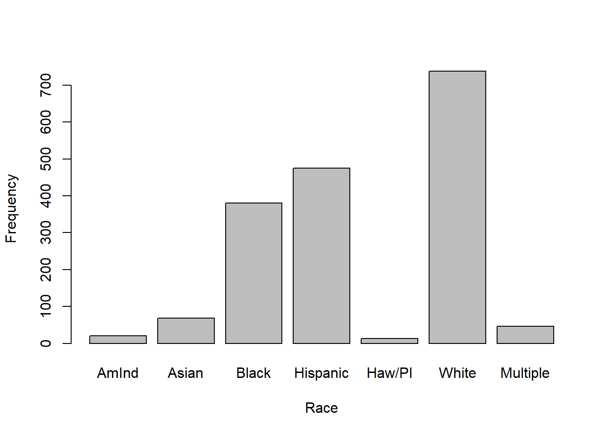
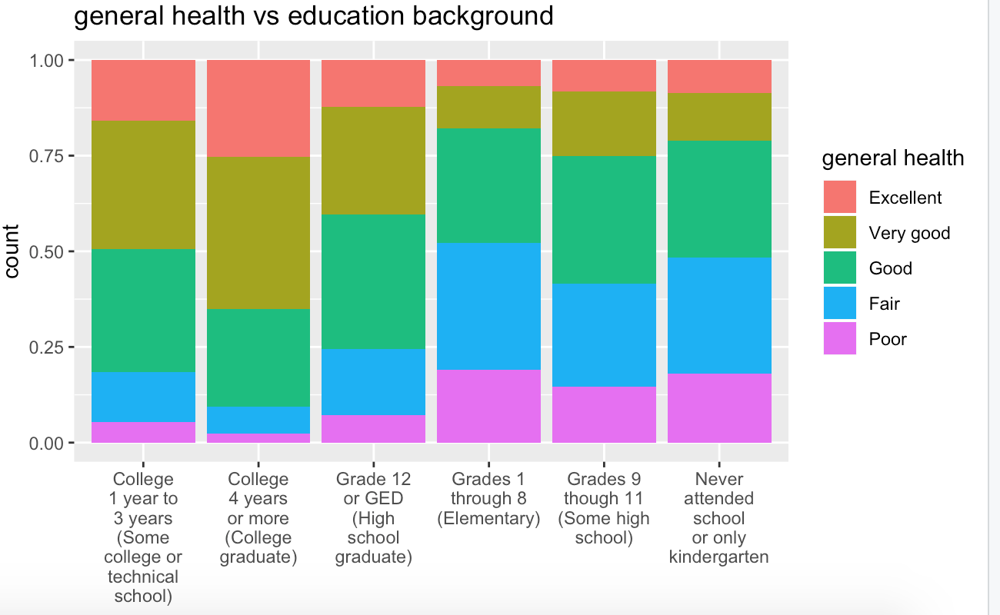
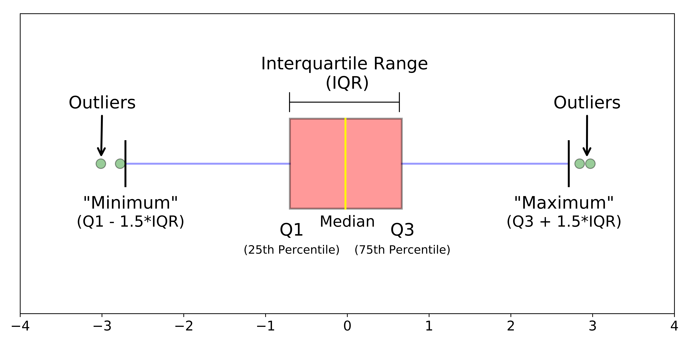

## Checklist {.smaller}

I hope you all had a wonderful Fall Break!

-- Please open up your `data-viz` project. 

-- Midterm-1 grades are posted! Please see the Moodle announcement

      > Regrade window opens up after class; due Friday 5:00pm

-- The Statistics Experience is LIVE!

-- Homework-3 next week is assigned

-- Quiz-5 is assigned

-- Proficiency test IV next Tuesday! Normal (fun) lab today!

## Road Map

Part-1 

      > The ggplot basics + structure 
      > The Dos and Don'ts of data visulaization 
      > Which plots are appropriate 
      
Part-2 

      > More advanced plotting tools
      > Answering research questions
      
## Warm-up 



## Warm-up



## Warm-up 



## Warm-up



# Plots

## What types of plots can we make?

**Golden Rule:** We can only use certain plots depending on the type of data we are working with!

-   Quantitative

-   Categorical

## Pick a plot

What plot is appropriate to graph the following scenarios

::: columns
::: {.column width="50%"}
-- One quantitative variable

-- One quantitative variable; one categorical variable

-- Two quantitative variables

-- One categorical variable

-- Two categorical variables
:::

::: {.column width="50%"}
-- Scatter plot

-- Histogram

-- Bar plot

-- Segmented bar plot

-- Box plot
:::
:::

## Scatter plot

## Scatter plot

Two quantitative variables

```{r}
#| eval: false
#| echo: false

data |>
  ggplot() +
  geom_point()
```



## Histogram

## Histogram

One quantitative variable



```{r}
#| eval: false
#| echo: false

data |>
  ggplot() +
  geom_histogram()
```

## Bar plot

## Bar plot

One categorical variable



```{r}
#| eval: false
#| echo: false

data |>
  ggplot() +
  geom_bar() #or geom_col
```

## Segmented bar plot

## Segmented bar plot

Two categorical variables



```{r}
#| eval: false
#| echo: false

data |>
  ggplot() +
  geom_bar()
```

## Boxplot

## Boxplot

One quantitative; One categorical

```{r}
#| eval: false
#| echo: false

data |>
  ggplot() +
  geom_boxplot()
```



# How do we make graphs?

## The process

`mtcars`

You want to create a visualization. The first thing we need to do is set up the canvas...

## The process

|     `mtcars |>`
|         `ggplot()`

{width="400" height="400" fig-align="\"center"}

## The process

|     `mtcars |>`
|         `ggplot(`
|         `aes(`
|              `x = variable.name, y = variable.name)`
|                `)`

aes: describe how variables in the data are mapped to your canvas

## The process

`+` "and"

When working with ggplot functions, we will add to our canvus using `+`

## The process

|     `mtcars |>`
|         `ggplot(`
|         `aes(`
|              `x = variable.name, y = variable.name)`
|                `)` +
|         `geom_point()`

## The process

{width="400" height="400" fig-align="\"center"}

# AE

## factor 

```
data |>
  mutate(group = factor(group, levels = c("Control", "Treatment", "Placebo")))
```
```
data |>
  mutate(group = fct_relevel(group, "Control", "Treatment", "Placebo"))
```

You can also save your factor levels as an R-object, and use that in the functions as well! 


Ordering matters! You will see that in lab!

Note: `factor()` or `fct_relevel()` change your variable to a factor with levels, to be re-ordered!

Let's try it!


## colors 

We can do a lot with color! 

-- `scale_color_manual()`

-- `scale_color_gradient()`

-- `scale_color_viridis_()`

## colors

We can be very direct on where we want the color to go!

```
scale_fill_manual(
    values = c(
      "Adelie" = "lightskyblue1",
      "Chinstrap" = "chartreuse3",
      "Gentoo" = "gold2"
    )
  )
```

Let's try it! 

## Recap of AE {.smaller}

-- Construct plots with `ggplot()`.

-- Layers of ggplots are separated by `+`s.

-- Aesthetic attributes of a geometries (color, size, transparency, etc.) can be **map**ped to variables in the data or **set** by the user.

-- Use `facet_wrap()` when faceting (creating small multiples) by one variable and `facet_grid()` when faceting by two variables.

