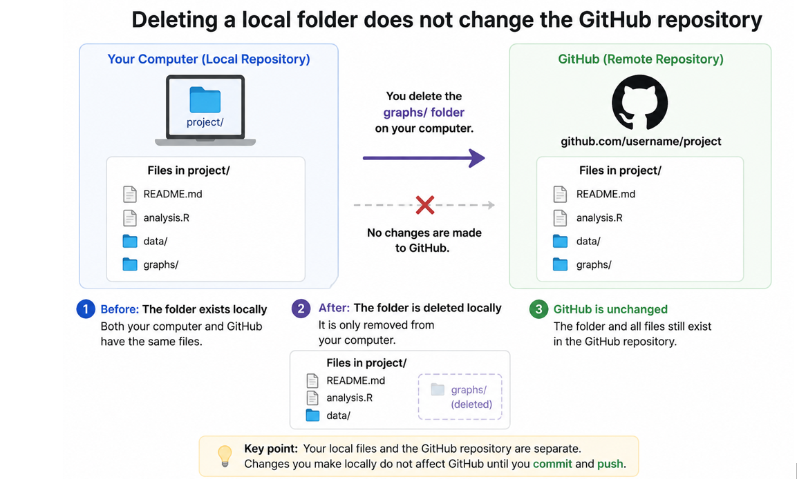
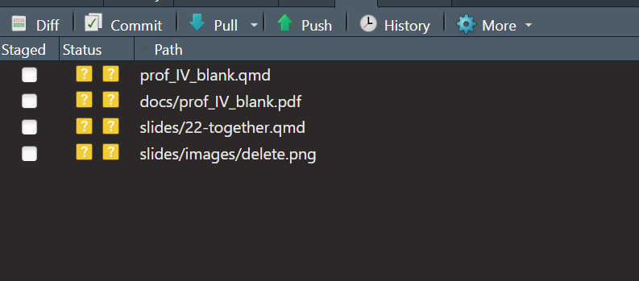
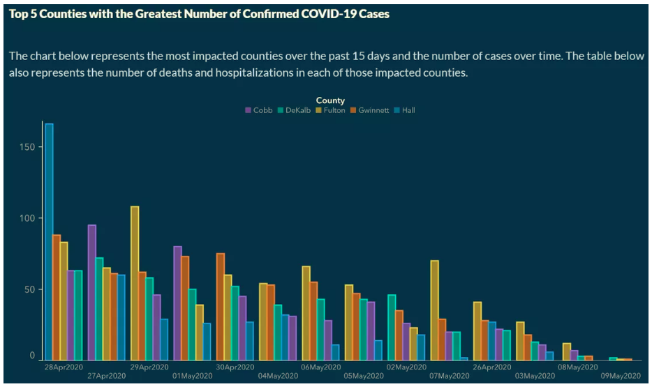

## Checklist{.smaller}

```{r}
#| echo: false
#| warning: false
#| message: false

library(tidyverse)
```


-- Please clone your `putting-it-together` project. We will work in this today!

-- The Statistics Experience is LIVE!

-- Quiz-6 comes is LIVE (due Saturday)

-- Proficiency test V (11-17)

-- Project instructions will come out by Friday

-- Final Exam (12-3)

## Announcement 

Sometimes (especially Mac users), you need to tell Git to *merge* rather than *rebase* when you pull. Some of you noticed last time that, when you pulled for the first time to merge files, you got asked to type the following in your **terminal**.


`git config pull.rebase false`

## Warm-up

-- When will GitHub auto-merge changes? 

## Warm-up{.smaller} 

What is this called? What caused this? 

```
<<<<<<< HEAD 

See also: [dplyr documentation](https://dplyr.tidyverse.org/)   

======= 

See also [ggplot2 documentation](https://ggplot2.tidyverse.org/)

>>>>>>> some1alpha2numeric3string4
```

## Warm-up{.smaller} 

How do I resolve this? 

```
<<<<<<< HEAD 

See also: [dplyr documentation](https://dplyr.tidyverse.org/)   

======= 

See also [ggplot2 documentation](https://ggplot2.tidyverse.org/)

>>>>>>> some1alpha2numeric3string4
```

## Things to note



# Two rules to follow

## Rule 1

Commit everything! Do not selectively commit files.

If you make changes to a .qmd file, you should also render the updated PDF or HTML file and commit those changes.

Your repository should always contain a consistent version of your work. We don't want a situation where the .qmd file reflects one version of an assignment, but the PDF or HTML file reflects an older version.

## Rule 1

Commit everything! 



## Rule 2{.smaller}

Follow this workflow!

A good group-work workflow looks like:

1. Stage and commit your local changes.

2. Pull the latest changes from GitHub.

3. Resolve any merge conflicts if necessary.

4. Push your changes to GitHub.

---

2. Committing saves a snapshot of your local work in Git's history. This means Git has a clear record of your changes when it tries to merge incoming changes.

## Project 

When working on your project, please reference the previous two slides. 

# Questions?

## Project 

-- Find your own data 

-- Ask something interesting/meaningful 

-- Explore it with tools we have learned in this class!

For the rest of class, we are going to practice working with an exploring data. 

## Extension Questions{.smaller}

The Portland Trailblazers are a National Basketball Association (NBA)
sports team. These data reflect the points scored by 9 Portland
Trailblazers players across the first 10 games of the 2021-2022 NBA
season.

We will work with the `trailblazer.csv` data first. 

## Question 

I want to explore these data, and make a data visualization that: 

-- Shows the points scored for each player

-- Shows if they did this on the road or at home 

-- I want to be able to also compare how they are doing over time

## 

```{r}
#| echo: false 
trailblazer <- read_csv("data/trailblazer21.csv")

new.blazer <- trailblazer |>  # save object as new.blazer
  pivot_longer( #make data longer
    cols = -Player, #bring all cols but Player down
    names_to = "Game", #name the col Game
    values_to = "Points", #name the values col Points
  ) |> 
  separate_wider_delim(Game , delim = "_", names = c("Game" , "Location"))

ggplot(
  new.blazer,
  aes(x = Game, y = Points, color = Location, group = 1)
) +
  geom_line(color = "gray70") +
  geom_point(size = 3) +
  facet_wrap(~ Player) +
  scale_color_manual(
    values = c(
      "Home" = "steelblue",
      "Away" = "darkorange"
    )
  ) +
  labs(
    title = "Trail Blazers Player Performance Across Games",
    x = "Game",
    y = "Points Scored",
    color = "Location"
  ) +
  theme_minimal() +
  theme(axis.text.x = element_text(angle = 90, hjust = 1))
```

## New Functions 

-- separate_wider_delim()

-- More with theme()

## How to get started

-- Explore your data 

-- What do our data need to look like to recreate the plot?

# Questions

## Extension Question 

Georgia Department of Public Health (DPH) temporarily published the following graph on the COVID-19 Daily Status Report.

-- What is misleading about this graph?

-- Why might it be misleading?




## Georgia 

The dates on the x-axis are not in chronological order.

This is extremely misleading, and a general audience is going to assume a correct chronological order to the dates from left to right.

Further, the order of the counties within date are sorted from highest to lowest, making cross date comparison more difficult for each county.

## Activity 

The data, gathered from the New York Times, that are used to create the data visualization can, can be found in your data folder.

Use the `georgia_covid` data frame above to recreate the visualization with the correct order on the x-axis and same order of counties for each date.

-- Explore the data 

-- Come up with a plan 

-- Re-create the plot!

## Let's go further 

- Make the bars skinnier by adding a `width` argument with a value less than 1 to `geom_col()`.
- Use `scale_x_date()`to change the breaks and labels of the x-axis.
- Use `scale_fill_manual()` to match the colors in the original plot.
- Use `labs()` to modify a axis labels and the label of the legend as well as add a  `title` and a `subtitle`.
- Use `theme_classic()` to remove the gridlines.

## `theme()` is really flexible{.smaller} 

- Modify a bunch of `theme()` elements to match the colors and other features of the original plot.

```
  theme(
    panel.background = element_rect(fill = "#182F4E"),
    plot.background = element_rect(fill = "#182F4E"),
    axis.line = element_line(color = "white"),
    axis.text = element_text(color = "white"),
    axis.title = element_text(color = "white"),
    legend.background = element_rect(fill = "#182F4E"),
    legend.position = "top",
    legend.text = element_text(color = "white"),
    legend.title = element_text(color = "white", hjust = 0.5),
    legend.title.position = "top",
    title = element_text(color = "white")
  )
```

## Interpretation 

Using our new graph, what proper conclusion can we make about the trend of casses across the five counties?

## Interpretation 

Based on the less misleading graph, we can see that the overall trend of cases across the five counties may have gone down, but the rate in which they went down depends on the county.

Further, some counties (ex. Hall) show a more cyclic pattern than an overall downward trend.

# Questions 

# See you next week!


