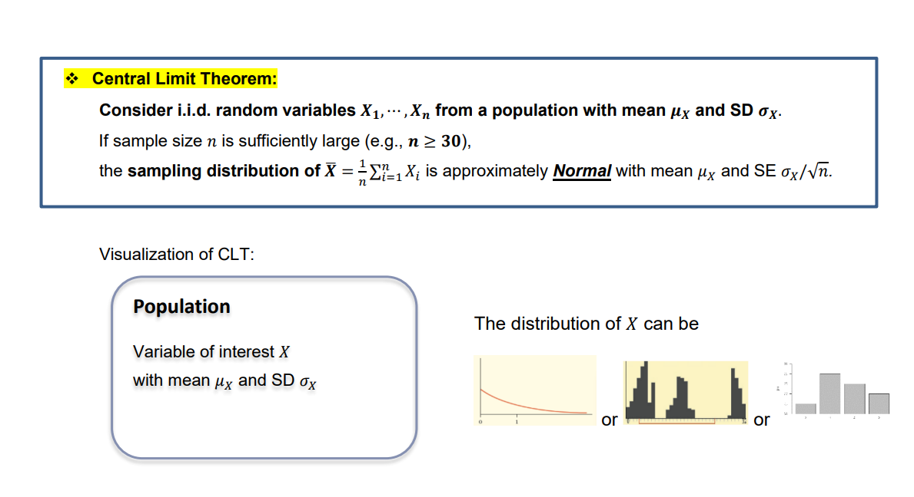
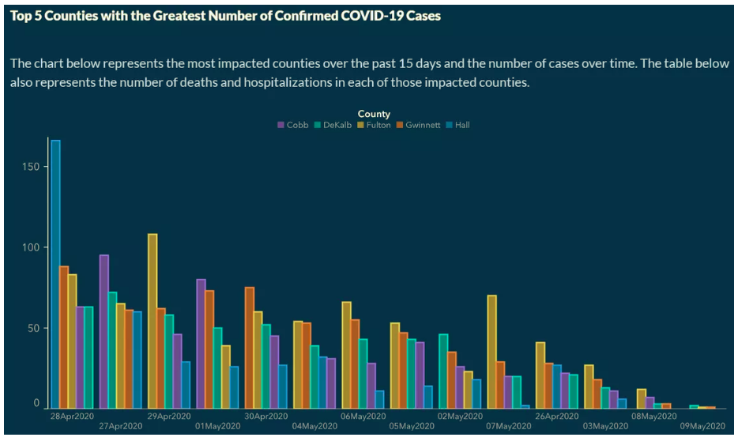

## Checklist {.smaller}

```{r}
#| echo: false
#| warning: false
#| message: false

library(tidyverse)
```

-- Please clone your `clt` project. We will work in this today!

-- If time, we will finish the georgia task in the `putting-it-together` repo.

-- in-class solutions are posted

-- The Statistics Experience is LIVE!

-- Your GitHub project is LIVE! Let's talk about it

-- No Lab (11-24)

-- No Quiz or Homework this week (get started on your project!)

-- Proficiency test V (11-17)

-- Final Exam (12-3)

## GitHub Project{.smaller}

*Ask and answer a research question using the tools we have learned in
class*!

Pick something you are interested in + excited about

Put enough time into this project to where you feel comfortable showing
off your work

## GitHub Project{.smaller}

*Ask and answer a research question using the tools we have learned in
class*!

-- Use bibtex to cite any resources you use

-- Use some `dplyr` functions on your data (create a new variable;
manipulate a variable; join data sets; etc.)

-- Have an appropriate number of GitHub issues created + responded to
for each team member

-- Practice using a proper GitHub workflow (ex. have meaningful multiple
commits by each team member)

-- Have a clean repo. This includes not having unnecessary files in your
repo; having your data in a data folder; etc.

## bibtex

Let's demo this in your `putting it together` repo!

[Citations](https://quarto.org/docs/authoring/citations.html) are an
important part of research. Quarto can use bibtex files (.bib) to
automatically generate citations and a bibliography in a number of
styles.

```         
---
title: "My Document"
bibliography: references.bib
---
```

## bibtex

**DOI** (Digital Object Identifier) is a unique, permanent alphanumeric
string assigned to an online document, dataset, or digital object to
provide a reliable web address that never breaks.

DOI: 10.1111/ssm.12430

## Export bibtex 

[Article here](https://arxiv.org/abs/2508.03952)

Many articles have *Export to bibtex*!

## Data citation{.smaller} 

[Kaggle](https://www.kaggle.com/datasets/mohankrishnathalla/student-academic-performance-and-dropout-risk)

```
@misc{thalla2026student,
  author       = {Thalla, Mohan Krishna},
  title        = {Student Academic Performance and Dropout Risk},
  year         = {2026},
  howpublished = {Kaggle},
  url          = {https://www.kaggle.com/datasets/mohankrishnathalla/student-academic-performance-and-dropout-risk}
}
```

```
The data were obtained from Kaggle [@thalla2026student].
```

# Questions

# 115 & 120 

## Big idea 

One of the more foundational ideas in statistics in the **Central Limit Theorem**.

-- Review the topic 

-- Approach/explore it from a coding perspective

## Central Limit Theorem

-- What is it?

-- Why is it important? 

## Central Limit Theorem{.smaller}

```{r}
#| echo: false
library(ggplot2)
library(patchwork)

set.seed(123)

# Create population
population <- rexp(100000)

# Simulate sampling distribution
n_sim <- 5000
n <- 30

sample_means <- NA

for (i in 1:n_sim) {

  sample_data <- sample(population, n)

  sample_means[i] <- mean(sample_data)

}

# Population distribution
p1 <- ggplot(data.frame(population), aes(x = population)) +
  geom_density(fill = "steelblue", alpha = 0.5) +
  labs(
    title = "Population Distribution",
    subtitle = "Right-skewed",
    x = "Values",
    y = "Density"
  ) +
  theme_minimal(base_size = 13)

# Sampling distribution
p2 <- ggplot(data.frame(sample_means), aes(x = sample_means)) +
  geom_density(fill = "darkorange", alpha = 0.5) +
  labs(
    title = "Sampling Distribution",
    subtitle = paste("Sample Mean (n =", n, ")"),
    x = "Sample Means",
    y = "Density"
  ) +
  theme_minimal(base_size = 13)

# Arrow between plots
arrow_plot <- ggplot() +
  annotate(
    "segment",
    x = 0, xend = 1,
    y = 0.5, yend = 0.5,
    arrow = arrow(length = unit(0.3, "cm")),
    linewidth = 1.2
  ) +
  theme_void()

# Combine plots
p1 + arrow_plot + p2 +
  plot_layout(widths = c(1, 0.25, 1))
```


## Central Limit Theorem{.smaller}



**i.i.d -** 

Independent: The outcome of one observation does not influence the outcome of another observation.

Identically distributed: Every observation comes from the same probability distribution (same population, mean, and variance).

## From the lens of 115

Write a function that explores the CLT for single mean and single proportion (proportion is just a special case of single mean where data are 0, 1)!

What could/should my function include? 

## From the lens of 115{.smaller}

Write a function that explores the CLT for single mean and single proportion!

-- population data 

-- sample size from population (n)

-- number of simulations

`sample()` may also help us! Please see the help file for this. 

Why should we be using `set.seed()` here?

Note: Use the function to create the data, and plot the data outside of the function. You can use `ggplot()` or base R `hist()` for a quick histogram

## Min? Max? 

Do you know....? 

Probably not... but we can explore this via simulation!

## Min? Max? 

How can we change our function to be more flexible, and have it incorporate other statistics? 

## Min? Max? 

The sampling distributions of the sample minimum and maximum do not become approximately normal under the classical CLT.

They are examples of order statistics, and their limiting distributions depend on the underlying population distribution.

# Questions 

## Georgia

Georgia Department of Public Health (DPH) temporarily published the following graph on the COVID-19 Daily Status Report.

-- What is misleading about this graph?

-- Why might it be misleading?


## Georgia



