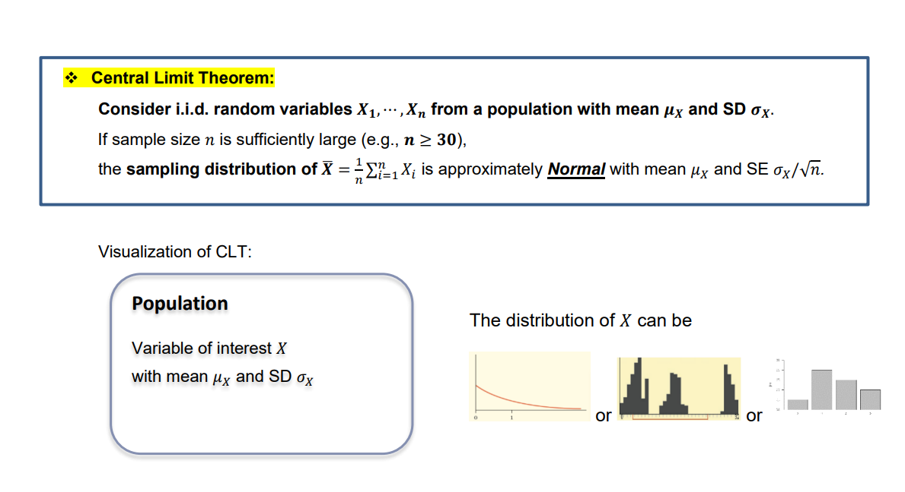
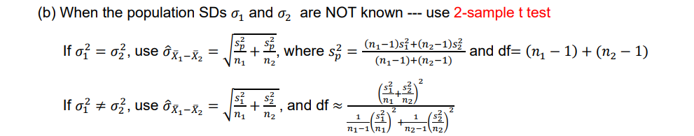
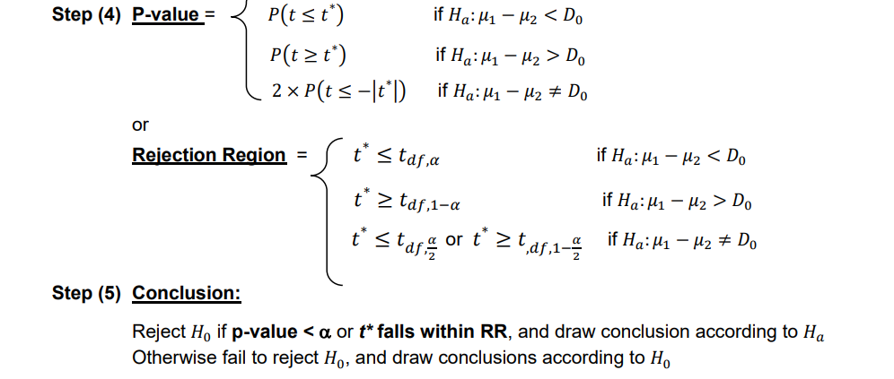

## Checklist {.smaller}

```{r}
#| echo: false
#| warning: false
#| message: false

library(tidyverse)
library(palmerpenguins)

penguins_sub <- penguins |>
  filter(species != "Chinstrap")
```

-- Please clone your `t-test` project. We will work in this today!

-- We will finish our central limit theorm discussion in the `clt` repo.

-- I made an announcement about bibtex. Did you see it?

-- in-class solutions are posted

-- The Statistics Experience is LIVE!

-- Your GitHub project is LIVE!

-- No Lab (11-24)

-- No Quiz or Homework this week (get started on your project!)

-- Proficiency test V (11-17)

-- Final Exam (12-3)

## Central Limit Theorm 



## Central Limit Theorm 

-- Wrote a function to simulate the properties of the central limit theorem 

-- Manipulated our function to calculate a variety of statistics 

-- Discovered that the CLT does not work for the min and max 

TODO

-- Let's explore proportions

-- Let's explore other distributions 

-- Let's explore the normal distribution 

# Questions 

## Comparing Two Means 

We want to do inference on $\mu_1$ - $\mu_2$

## Motivating Question 

I want you to compare the mean flipper length between Adelie penguins and Gentoo penguins from the `palmerpenguins` package. Specifically, I want to investigate if the mean flipper length is different between these two species. 

## Explore the data 

Calculate some relevant summary statistics that helps investigate your research question. 

## Null and Alternative 

I want you to compare the mean flipper length between Adelie penguins and Gentoo penguins from the `palmerpenguins` package. Specifically, I want to investigate if the mean flipper length is different between these two species. 

$Ho:$

$Ha:$

## Things to check 

Assumptions... 

... what are they?

## Assumptions 

-- Independence 

-- Normality 

How do we do this?

## Assumptions 

If we don't have evidence that either assumption is rejected, what does this mean?

Why did we check our assumptions in the first place? 

## The statement 

"If the assumptions of our hypothesis test are not violated, then our test statistic follows a known theoretical sampling distribution, assuming the null hypothesis is true."

What is our test statistic? 

What is our distribution? 

## Code 

What is this code doing? 

```{r}
#| echo: true
#| eval: false

t.test(flipper_length_mm ~ species,
       data = penguins_sub,
       var.equal = TRUE)
```

Next, run this code, what does it tell us? 

## degrees of freedom 



## p-value



## if time 

Our test statistic is -34.415

Using R, recreate it! Or at least, let's put the pieces in place! 

## t-distribution 

We use stat_function() because we want ggplot to calculate and plot the y-values of a mathematical function over a continuous range of x-values.

```{r}
#| echo: true
#| eval: false

ggplot(data.frame(x = c(-4, 4)), aes(x)) +
  stat_function(
    fun = dt,
    args = list(df = 268) # args expects a list 
  ) +
  labs(
    title = "t-Distribution (df = 268)",
    x = "t",
    y = "Density"
  )
```

## other distributions 

```{r}
#| echo: true
#| eval: false
ggplot(data.frame(x = c(-4, 4)), aes(x)) +
  stat_function(fun = function(x) dnorm(x, 0, 1))

ggplot(data.frame(x = c(0, 5)), aes(x)) +
  stat_function(fun = function(x) exp(x))
```


