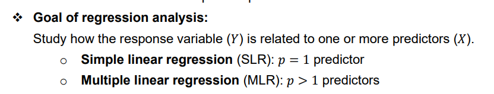
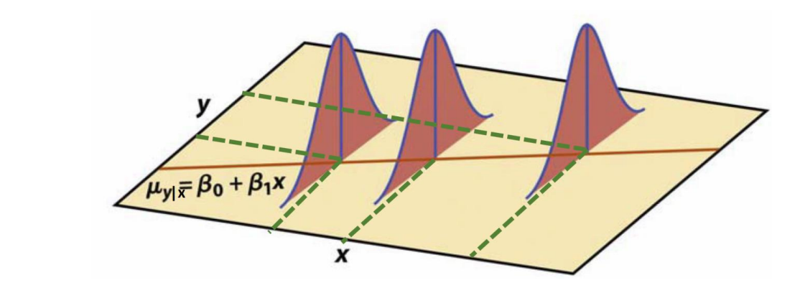
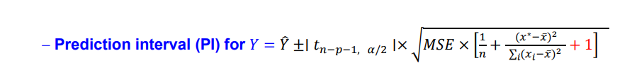
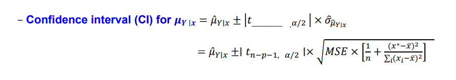
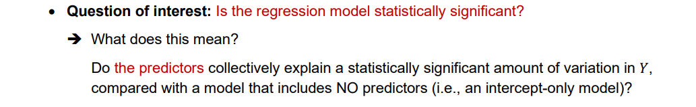

## Checklist {.smaller}

```{r}
#| echo: false
#| warning: false
#| message: false

library(tidyverse)
library(palmerpenguins)
library(tidymodels)

tickets <- read_csv("data/customer_service_tickets115.csv", skip = 3)

```

-- Please clone your `regression` project. We will work in this today!

-- I made an announcement about bibtex. Did you see it?

-- The Statistics Experience is LIVE!

-- Your GitHub project is LIVE!

-- Proficiency test V (11-17)

-- No Lab (11-24)

-- Quiz is live due Friday at 11:59pm

-- Final Exam (12-3)

## Road Map 

Tuesday's class (optional) - [RShiny](https://shiny.posit.co/)

Tuesday back from break - Review day 

## Course evaluations

We are going to take 5-minutes to fill out the course evaluation:
http://go.ncsu.edu/cesurvey

These are important!

> I take them very seriously, and will read them after the semester The
> department takes them very seriously

## 

You are my favorite ST 115 class I’ve ever taught at NC State!

{fig-align="center"}

## Warm-up 

-- What is regression analysis?

-- What are some of the goals of regression analysis?

## Goals 




## Motivating Example{.smaller} 

A company wants to understand what factors influence the time required to resolve customer service tickets. They collected data on 150 tickets, recording resolution time, ticket complexity, agent experience, number of customer interactions, ticket priority, and contact channel.

We are going to start with a *simple linear regression model* that uses agent years of experience as the explanatory variable, to explain the changes that we see in our response variable, hours until resolution.  

-- Load in the data

-- Create some summary statistics 

-- Create an appropriate plot

## Tasks 

-- Fit the simple linear regression model using `lm()`

-- Interpret coefficients 

-- Make predictions 

## Take note



## Residuals Task 

Let's put our coding skills to the test. 

I want to know which observation had the *largest* and *smallest* residual. Let's think about how we could do this!

Hint: You can pull the residuals directly using `residuals(model)`!

```{r}
#| eval: false 
#| echo: false

residuals(model) |>
  as_tibble() |> 
  mutate(id = 1:nrow(tickets)) |>
  arrange(desc(value)) |>
  slice(1, nrow(tickets))
```

## Predictions{.smaller} 

```{r}
#| eval: false
#| echo: true
predict(model, newdata = data.frame(agent_experience_years = 10))
```

Suppose I was really interested in reporting the predicted mean resolution hours when the agent had 10 years of experience. How could I efficiently do that in the body of a paragraph?

## Prediction Interval vs Confidence Interval 

What's the difference?

## Prediction Interval vs Confidence Interval 






## R Code{.smaller} 

```{r}
#| eval: false
#| echo: true
predict(
  model,
  newdata = data.frame(agent_experience_years = 10),
  interval = "prediction", # or "confidence"
  level = 0.95
)
```

## Note

You can also make confidence interval for $\beta_1!$

As a reminder, you would need to check assumptions to trust your statistical inference procedure. We will do that in the next demonstration.

## Hypothesis Test 

What if I wanted to test to see if there is a true linear relationship between resolution time and agent experience? 

$Ho:$

$Ha:$

## Hypothesis Test 

What if I wanted to test to see if there is a true linear relationship between resolution time and agent experience? 

$Ho: \beta_1 = 0$

$Ha: \beta_1 \neq 0$

What do I need to check now? 

## Assumptions{.smaller}  

```{r}
#| echo: true
model <- lm(resolution_hours ~ agent_experience_years, data = tickets)
plot(model, which = 1)
```


## Assumptions{.smaller}  

```{r}
#| echo: true
plot(model, which = 2)
```


## Overall F-test 



```
anova(model)
```

There is a special relationship between a t-statistic and a F-statistic with numerator 1 df. What is it? 

# Questions

# if time

## Multiple Linear Regression 

Why? 

## Overall F-test 

Don't forget to check your assumptions for each model first!

```
anova(model_additive, model_interaction)
```

# Questions?

## Tuesday 

[RShiny](https://shiny.posit.co/)

