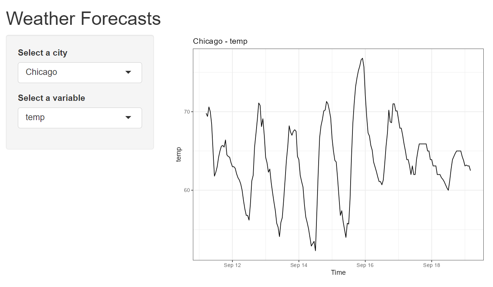

## Checklist {.smaller}

```{r}
#| echo: false
#| warning: false
#| message: false

library(tidyverse)
library(palmerpenguins)
library(tidymodels)
```

-- Please clone your `r-shiny-demo` project. We will work in this today!

-- The Statistics Experience is LIVE!

-- Your GitHub project is LIVE!

-- No Lab (11-24)

-- I posted the `tickets` data set to Moodle.

-- If you didn't do course evaluations, please do so!

-- Final Exam (12-3)

-- `install.packages("shiny")` <- you will need this for today's activity

## R-Shiny 

[Shiny apps](https://shiny.posit.co/) let users interact with your data and your analysis!

[My shiny app](https://dbuwgu-elijah0meyer.shinyapps.io/r-shiny-randomization-app/)

## Shiny gallery 

[This gallery](https://shiny.posit.co/r/gallery/) is a very useful resource to be inspired by and to learn from!

## Before we start

We won't be experts on Shiny after a couple of slides. I'm giving you the "basics" to think about, and then we will practice in our in-class activity!

## The basics 

User interface (UI) - what does the user see?

The server - what happens behind the scenes? 

## UI 

| Function | Purpose |
|:---|:---|
| `fluidPage()` | Creates the overall page |
| `titlePanel()` | Adds a title |
| `sidebarLayout()` | Creates a sidebar and main panel |
| `sidebarPanel()` | Holds user inputs |
| `mainPanel()` | Holds outputs |
| `selectInput()` | Creates a dropdown |
| `plotOutput()` | Creates a location for a plot |

## UI example 

```
selectInput(
  "city",
  "Select a city",
  choices = c("Chicago", "Durham", "Sedona")
)
```

## Widget{.smaller} 

In Shiny, a widget is an interactive user-interface element that allows someone to provide input or interact with an app.

| Widget | Shiny function |
|:---|:---|
| Dropdown menu | `selectInput()` |
| Slider | `sliderInput()` |
| Checkbox | `checkboxInput()` |
| Radio buttons | `radioButtons()` |
| Text box | `textInput()` |
| Action button | `actionButton()` |

## Connecting inputs and outputs 

I would emphasize that the UI and server have to communicate through matching IDs.

| UI | Server |
|:---|:---|
| `selectInput("city", ...)` | `input$city` |

## reactivity 

`reactive()` is defined inside the server function.

What is your definition of reactive?

## reactivity 

`reactive()` is defined inside the server function.

reactive() creates a value that automatically recalculates when the inputs it depends on change.

```
weather_city <- reactive({
  weather |>
    filter(city == input$city)
})
```

## how we start{.smaller}

```
library(shiny)

shinyApp(

  # User interface
  ui = fluidPage(

  ),

  # Server logic
  server = function(input, output, session) {

  }

)
```

# r-shiny-demo

## weather data

-- Read in these data in a .R file

-- Explore these data 

-- Come up with some interesting ideas on how to explore these data through an interactive platform; What could be useful for a general audience? 

# filler 

## inspiration 



## Shiny for R cheatsheet

[Link](https://shiny.posit.co/r/articles/start/cheatsheet/)

## Consideration 

What do we need to consider?

## Consideration

-- weather for selected city

-- weather variables that are numeric

-- update the variable dropdown

-- make plot

## Deploying shiny apps 

[Connect Cloud](https://connect.posit.cloud/?utm_source=chatgpt.com)

Typically can host a couple for free, and have to pay for more.
