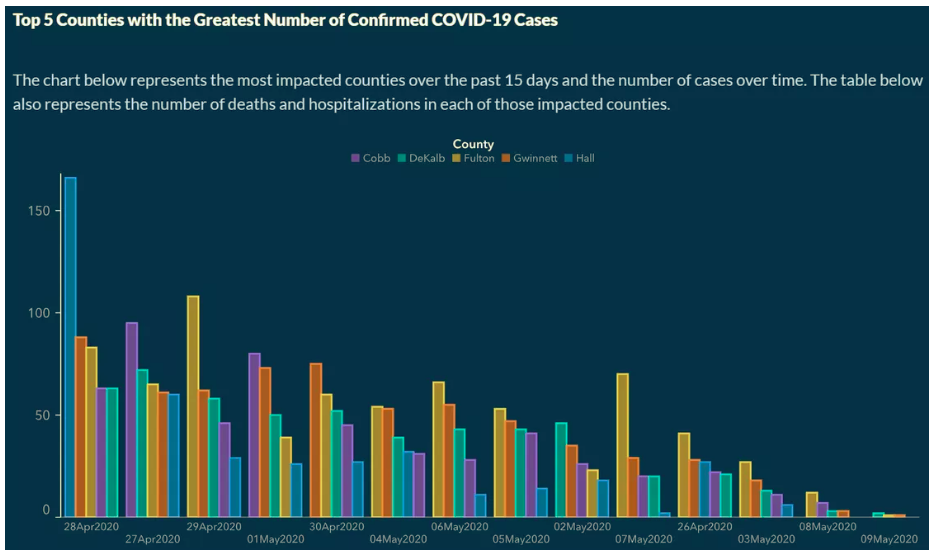

## Today's lab

-- Practice critiquing plots

-- Re-creating plots to be more clear/effective

-- Interpreting plots

Clone your georgia-lab repo, and we will get started!

This lab is due **Friday** at 11:59pm on Gradescope.

## Georgia

Georgia Department of Public Health (DPH) temporarily published the
following graph on the COVID-19 Daily Status Report.

-- What is misleading about this graph?

-- Why might it be misleading?

## Georgia



## Georgia

The dates on the x-axis are not in chronological order.

This is extremely misleading, and a general audience is going to assume
a correct chronological order to the dates from left to right.

Further, the order of the counties within date are sorted from highest
to lowest, making cross date comparison more difficult for each county.

## Activity

The data, gathered from the New York Times, that are used to create the
data visualization can, can be found in your data folder.

Use the `georgia_covid` data frame above to recreate the visualization
with the correct order on the x-axis and same order of counties for each
date.

-- Explore the data

-- Come up with a plan

-- Re-create the plot!

## Let's go further

-   Make the bars skinnier by adding a `width` argument with a value
    less than 1 to `geom_col()`.
-   Use `scale_x_date()`to change the breaks and labels of the x-axis.
-   Use `scale_fill_manual()` to match the colors in the original plot.
-   Use `labs()` to modify a axis labels and the label of the legend as
    well as add a `title` and a `subtitle`.
-   Use `theme_classic()` to remove the gridlines.

## `theme()` is really flexible {.smaller}

-   Modify a bunch of `theme()` elements to match the colors and other
    features of the original plot.

```         
  theme(
    panel.background = element_rect(fill = "#182F4E"),
    plot.background = element_rect(fill = "#182F4E"),
    axis.line = element_line(color = "white"),
    axis.text = element_text(color = "white"),
    axis.title = element_text(color = "white"),
    legend.background = element_rect(fill = "#182F4E"),
    legend.position = "top",
    legend.text = element_text(color = "white"),
    legend.title = element_text(color = "white", hjust = 0.5),
    legend.title.position = "top",
    title = element_text(color = "white")
  )
```

## Interpretation

Using our new graph, what proper conclusion can we make about the trend
of casses across the five counties?

## Interpretation

Based on the less misleading graph, we can see that the overall trend of
cases across the five counties may have gone down, but the rate in which
they went down depends on the county.

Further, some counties (ex. Hall) show a more cyclic pattern than an
overall downward trend.

# Questions
