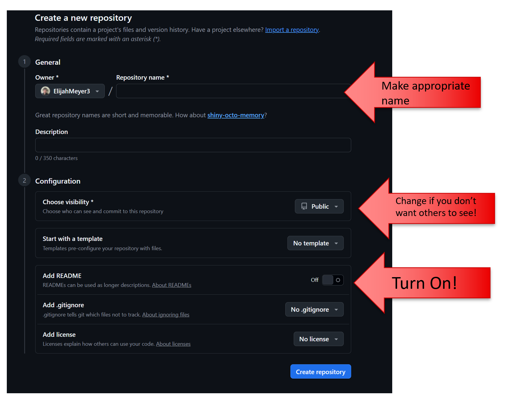

## Learning Objectives 

-- More practice with GitHub

      > Can you create your own repo 
      > Can you clone a repo 
      > Can you push to a repo 
      
-- R Packages 

      > What are they good for
      > The difference between install and library
      
      
## Creating a Repo 

Let's do the lab-setup together!

-- Click your profile icon and click Repositories

-- Click "New" 

## Creating a Repo 




## Packages

Think of R itself as a basic toolbox. Packages are like specialized toolkits that you can add when you need them.

There are two steps you need to remember with packages: 

-- `install.packages()`

-- `library()` 

## Packages 

Most of the time, you install R packages from CRAN, which stands for the Comprehensive R Archive Network.

You don't usually have to visit a website yourself. R can download the package for you.

[CRAN](https://cran.r-project.org/)

## Questions 2-3

Based on what we know about when to put code in our Quarto document...

Should `install.packages()` go in your .qmd file, or should this be typed in your Console?

Should `library()` go in your .qmd file, or should this be typed in your Console?

## Push

Before moving on, make sure that we are practicing good GitHub practices. 

-- Render your document 

-- Stage **everything** (see slides for shortcut in terminal)

-- Commit everything and write a commit message (a commit message is necessary for this to work)

-- Push when you see that your branch is 1 commit ahead

## Question 4

Try to run this code. Does it work?

```{r}
#| eval: false
#| echo: true

palmerpenguins::penguins
```

## Question 4 

We can reference a function or a data set from a package directly using :: ! 

So, that means we are typing the sentence: 

"In the palmerpenguins package, access the penguins data set" 

And you don't have the palmerpenguins package installed yet. Do it now! 

## Question 5 

Do we need to library the palmerpenguins package for the code to work if we access the package directly? Try it without and see.

## Question 6 

Sometimes, when you open packages, they will give you warning messages. How can we remove those?

## Question 7 

We can access the help file for a package just like we did with function names. Let's pull up the help file for `dplyr` and follow the first Useful link. Let's explore a new function called arrange. 

## Question 8 

As seen in class, you can click the clock icon underneath Code to see your commits! Screenshot this and embed this picture into your document. Please look at previous assignments / slides if you need help remebering how to do this. 
